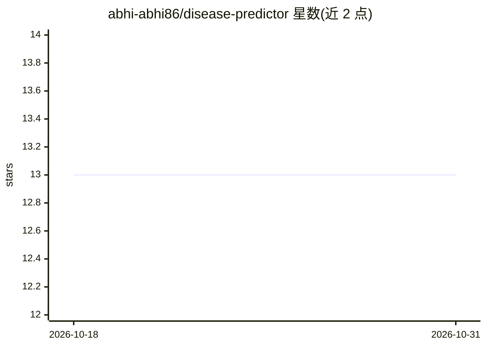

# abhi-abhi86/disease-predictor

⭐ 13 · Python · MIT · 推送 2026-03-27 · [GitHub](https://github.com/abhi-abhi86/disease-predictor) · [官网](https://github.com/abhi-abhi86/disease-predictor.git) · 个人维护

**离线桌面应用：从图像检测植物、人、动物疾病**

基于 PyTorch MobileNetV2 与 PySide6 的桌面 GUI 应用，对上传图像做疾病分类检测，覆盖 26 个疾病类别（植物 13、人 6、动物 7），带置信度阈值（默认 55%）与无效图像自动拒绝。内置 27+ 疾病数据库、PDF/HTML 报告生成、Folium 地理分布图、BM25 检索，并可抓取 Wikipedia/PubMed 研究资料。离线运行、数据不离开本机、无需 API key；支持自定义数据集训练（预训练模型随附，训练可选）。安装需 Python 3.14+，通过 git clone 与 pip 完成源码运行。

## 筛选速览

| 维度 | 判定 | 备注 |
|---|---|---|
| AI 角色 | `ai-native` | 本体是模型或模型工具 |
| 许可风险 | `permissive` | MIT |
| 部署形态 | `library` | 以包/库形式分发 |
| 模型依赖 | — | README 未给出锁定关系 |
| 硬件要求 | — | 无带数字的原话,不猜 |
| 安装摩擦 | `low` | 无编译、无系统依赖或容器化 |
| 成熟度 | — | 结构信号不足 |

## 能力要点

- MobileNetV2 检测 26 个疾病类别，含置信度阈值与无效图像拒绝
- 完全离线运行，数据留在本机，无外部 API 或云服务
- 附 27+ 疾病数据库、PDF/HTML 报告生成与 Folium 地图
- 支持自定义数据集训练模型，预训练模型随附

## 适用场景

- 拍下叶片/皮肤/动物患处照片，离线获取疾病检测结果与治疗建议
- 为作物、皮肤或牲畜疾病生成 PDF 报告并查看 PubMed/Wikipedia 研究
- 用自己的数据集重新训练疾病分类模型

## 场景标签

`目标检测` · 领域:感知与多模态

## 证据(README 行号)

> L9: > **AI-powered disease detection for Plants, Humans, and Animals | Desktop GUI Application | Offline-First | Privacy
> L32: - **🎯 AI-Powered Detection**: Deep learning model (MobileNetV2) trained on 26 disease classes

## 星数曲线

2026-10-18 13 → 2026-10-31 13（+0）

---
*卡片 v1 · prompt 1.4 · 生成 2026-10-31 · 置信度 high · 依据 README sha `6da15d340f35` · [字段定义](../../DATASET.md)*
