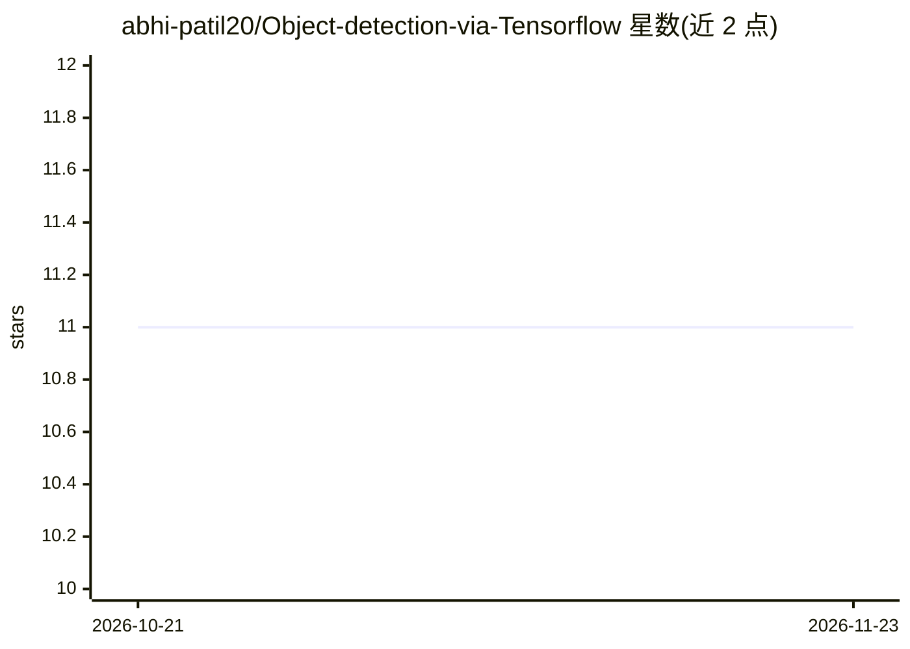

# abhi-patil20/Object-detection-via-Tensorflow

⭐ 11 · Python · 推送 2026-02-15 · [GitHub](https://github.com/abhi-patil20/Object-detection-via-Tensorflow) · 个人维护

**在 TensorFlow 2 下安装运行目标检测 API 的指引**

展示如何以 pip 或 Docker 两种方式安装 TensorFlow Object Detection API（TF2 版本）：Docker 路径使用仓库内提供的 Dockerfile 构建镜像并运行；pip 路径需先编译 protobuf 定义、复制 tf2 的 setup.py 后安装。最后提供 model_builder_tf2_test.py 测试脚本用于验证安装是否成功。面向需要部署容器化应用或本地 Python 环境安装该检测 API 的开发者。

## 筛选速览

| 维度 | 判定 | 备注 |
|---|---|---|
| AI 角色 | `ai-native` | 本体是模型或模型工具 |
| 许可风险 | `none` | — |
| 部署形态 | `self-host` | docker 或自建部署 |
| 模型依赖 | — | README 未给出锁定关系 |
| 硬件要求 | — | 无带数字的原话,不猜 |
| 安装摩擦 | `low` | 无编译、无系统依赖或容器化 |
| 成熟度 | — | 结构信号不足 |

## 能力要点

- 提供 Docker 与 pip 两种安装路径
- pip 安装含 protobuf 编译与 tf2 setup.py 步骤
- 附带安装验证测试脚本 model_builder_tf2_test.py

## 适用场景

- 在 Python 环境中安装 TensorFlow 目标检测 API
- 用 Docker 容器方式部署目标检测 API
- 安装后验证 API 可正常构建 TF2 模型

## 场景标签

`目标检测` `教程课程` · 领域:学习与行业

## 证据(README 行号)

> L7: You can install the TensorFlow Object Detection API either with Python Package Installer (pip) or Docker, an open-so
> L22: protoc object_detection/protos/*.proto --python_out=.
> L24: cp object_detection/packages/tf2/setup.py .

## 星数曲线

2026-10-21 11 → 2026-11-23 11（+0）

---
*卡片 v1 · prompt 1.4 · 生成 2026-11-18 · 置信度 mid · 依据 README sha `0be0564d7d79` · [字段定义](../../DATASET.md)*
