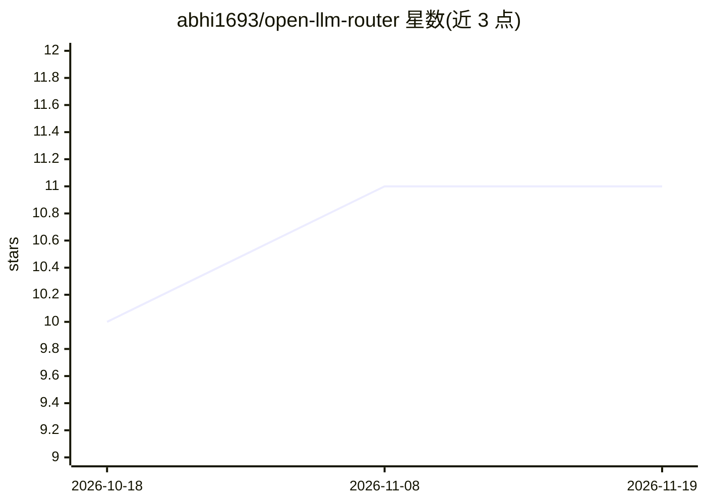

# abhi1693/open-llm-router

⭐ 11 · Python · 推送 2026-10-04 · [GitHub](https://github.com/abhi1693/open-llm-router) · 个人维护

**OpenAI 兼容的 LLM 请求网关：多提供商自动路由、故障转移与指标**

基于 FastAPI 的 API 网关，暴露 /v1/chat/completions 等 OpenAI 兼容端点，按 profile 配置将请求路由到多个已配置的提供商账号与模型。机制包括：model:"auto" 的任务/复杂度分类路由、429/5xx 时的 fallback 重试、熔断器与幂等重放、JSONL 审计日志、实时指标与 Prometheus /metrics。需 Python 3.12+，可选 Redis 共享幂等/指标存储；提供 Dockerfile 与 docker-compose 工作流，入口认证支持 API key 与 OAuth JWT。

## 筛选速览

| 维度 | 判定 | 备注 |
|---|---|---|
| AI 角色 | `ai-ecosystem` | LLM/agent 周边工具 |
| 许可风险 | `none` | — |
| 部署形态 | `self-host` | docker 或自建部署 |
| 模型依赖 | — | README 未给出锁定关系 |
| 硬件要求 | — | 无带数字的原话,不猜 |
| 安装摩擦 | `low` | 无编译、无系统依赖或容器化 |
| 成熟度 | — | 结构信号不足 |

## 能力要点

- model:"auto" 按任务与复杂度分类自动选型，含 fallback 链与请求级路由控制
- 熔断器、幂等重放、JSONL 审计日志与 Prometheus 指标端点
- 可选本地 embedding 语义分类器与路由重排序器（transformers/torch）
- profile 驱动配置（router.profile.yaml），内置 auto/balanced/cost/latency/quality 等路由配置

## 适用场景

- 在多个 LLM 提供商账号之间统一入口并自动分配请求
- 按成本/延迟/质量策略控制模型选择与回退顺序
- 为内部应用提供 OpenAI 兼容端点并记录审计与指标

## 场景标签

`模型网关` · 领域:Agent 开发

## 证据(README 行号)

> L3: Open-LLM Router is a FastAPI gateway that exposes OpenAI-compatible endpoints and routes requests across configured 
> L5: It supports `model: "auto"` routing, task/complexity-aware model selection, provider-aware failover, idempotency, li

## 星数曲线

2026-10-18 10 → 2026-11-19 11（+1）

---
*卡片 v1 · prompt 1.4 · 生成 2026-11-18 · 置信度 high · 依据 README sha `edd7edede6b0` · [字段定义](../../DATASET.md)*
