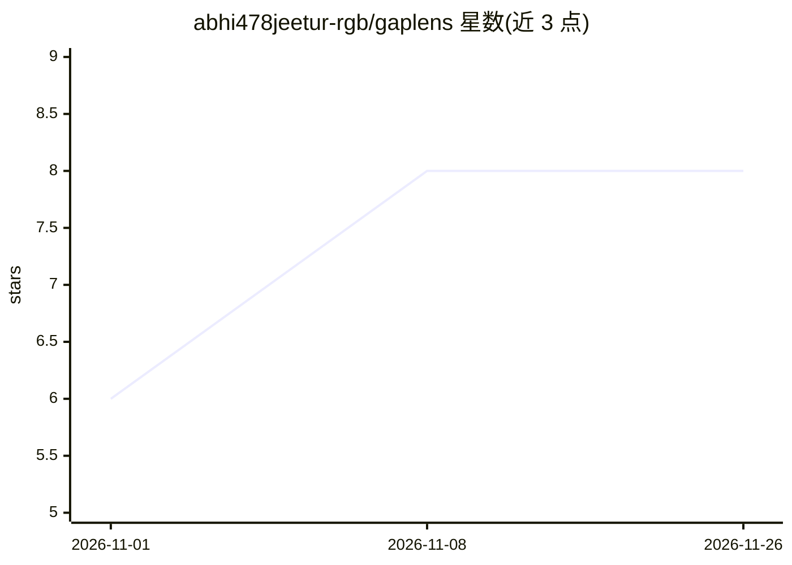

# abhi478jeetur-rgb/gaplens

⭐ 8 · TypeScript · MIT · 推送 2026-10-31 · [GitHub](https://github.com/abhi478jeetur-rgb/gaplens) · [官网](https://gaplens-nine.vercel.app/) · 个人维护

**跨来源检测信息缺口、冲突与过时事实的报告工具**

为 Shinchan Hackathon 2026 开发的信息缺口检测平台：用户输入一个问题与 2-6 个来源（链接或粘贴文本），系统先服务端抽取正文，再由 LLM 列出待核事实并逐源抽取带逐字引用的证据；引用在代码中比对原文，未核验引用不计入分数。输出已确认事实、覆盖缺口、来源冲突、过时源与覆盖评分地图，支持英文与印地语界面与报告。本地以 npm 运行，部署于 Vercel，LLM 通过 Groq 接入。

## 筛选速览

| 维度 | 判定 | 备注 |
|---|---|---|
| AI 角色 | `ai-native` | 本体是模型或模型工具 |
| 许可风险 | `permissive` | MIT |
| 部署形态 | `library` | 以包/库形式分发 |
| 模型依赖 | locked-api |  |
| 硬件要求 | — | 无带数字的原话,不猜 |
| 安装摩擦 | `low` | 无编译、无系统依赖或容器化 |
| 成熟度 | `idea` | |

## 能力要点

- 每个事实附代码核验的逐字引用（exact/near match/unverified 分级）
- 覆盖评分与地图从已核验证据确定性计算
- 一键离线 demo 与可导出的 Verify next 清单（PDF/Markdown/WhatsApp）
- 英文与印地语界面及报告

## 适用场景

- 对比多个来源回答同一问题时的信息缺口
- 核查资料来源之间的事实冲突
- 生成带引用的来源覆盖报告供后续逐条验证

## 场景标签

`科研工具` `文档解析` · 领域:知识与检索

## 证据(README 行号)

> L17: Give GapLens a question and 2 to 6 sources (links or pasted text). It returns:
> L73: 2. **Plan**: an LLM lists the specific, checkable facts a complete answer needs.
> L74: 3. **Evidence**: per source, the most relevant passages are selected in code and the LLM extracts facts with verbat

## 星数曲线

2026-11-01 6 → 2026-11-26 8（+2）

---
*卡片 v1 · prompt 1.4 · 生成 2026-11-20 · 置信度 high · 依据 README sha `e0877ee41846` · [字段定义](../../DATASET.md)*
