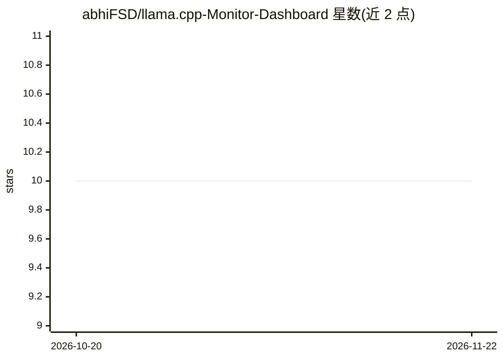

# abhiFSD/llama.cpp-Monitor-Dashboard

⭐ 10 · HTML · 推送 2026-03-13 · [GitHub](https://github.com/abhiFSD/llama.cpp-Monitor-Dashboard) · 个人维护

**llama.cpp 服务器的单文件实时监控仪表盘**

单个 HTML 文件构成的 llama.cpp server 监控面板，零依赖、无后端、纯浏览器端运行。轮询 llama.cpp 的 /metrics 与 /slots 端点，展示每槽位与聚合的 tok/s、槽位活跃状态、生成速度与活跃槽位的时间序列图表、已完成请求日志与服务器累计统计。可选通过 Python sidecar 脚本（Flask+psutil+GPUtil）采集 GPU/CPU/RAM 指标，无 NVIDIA GPU 时自动隐藏 GPU 卡片。要求 llama.cpp 以 --metrics 和 --slots 标志启动。

## 筛选速览

| 维度 | 判定 | 备注 |
|---|---|---|
| AI 角色 | `ai-ecosystem` | LLM/agent 周边工具 |
| 许可风险 | `none` | — |
| 部署形态 | `library` | 以包/库形式分发 |
| 模型依赖 | local-ok | 支持本地模型 |
| 硬件要求 | — | 无带数字的原话,不猜 |
| 安装摩擦 | `low` | 无编译、无系统依赖或容器化 |
| 成熟度 | — | 结构信号不足 |

## 能力要点

- 单 HTML 文件、零依赖、纯客户端运行，无需构建步骤
- 实时展示每槽位与聚合的 tok/s、槽位状态与请求日志
- 自动从 llama.cpp metrics 检测模型名与槽位数
- 可选 Python sidecar 提供 GPU/CPU/RAM/磁盘指标

## 适用场景

- 本地或远程运行 llama.cpp 时实时查看生成速度与槽位占用
- 排查多槽位并发下哪些请求在排队或活跃
- 配合 sidecar 监控推理服务器的 GPU/内存使用

## 场景标签

`LLM 可观测性` · 领域:评测与运维

## 证据(README 行号)

> L3: A single-file, real-time monitoring dashboard for llama.cpp server. Zero dependencies — just one HTML file.
> L134: The dashboard polls two llama.cpp endpoints:
> L139: Everything runs client-side in the browser. No backend, no build step, no dependencies.

## 星数曲线

2026-10-20 10 → 2026-11-22 10（+0）

---
*卡片 v1 · prompt 1.4 · 生成 2026-11-20 · 置信度 mid · 依据 README sha `75e61fef1eb6` · [字段定义](../../DATASET.md)*
