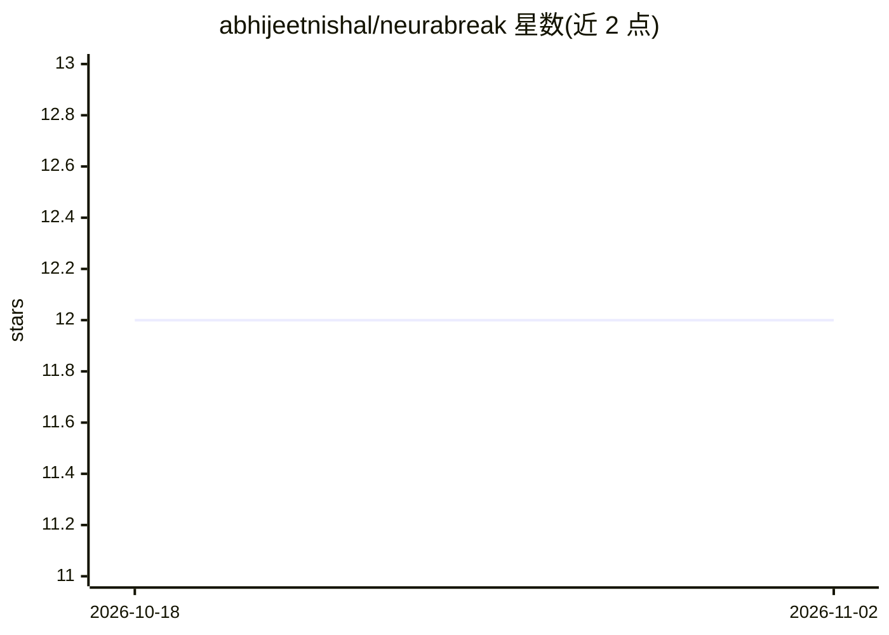

# abhijeetnishal/neurabreak

⭐ 12 · HTML · MIT · 推送 2026-05-23 · [GitHub](https://github.com/abhijeetnishal/neurabreak) · 个人维护

**久坐健康守护桌面应用：本地摄像头检测坐姿并提醒休息**

面向长时间伏案用户的健康提醒工具：基于摄像头人脸检测驱动会话计时，人离席自动暂停；YOLO 模型做坐姿好/坏分类（当前用基础模型而非定制训练）；提供 20-20-20 用眼提醒、四级升级通知、SQLite 健康日志与仪表盘。全部推理在本地运行，无云端、无账号、无遥测。Python 3.11+ 编写，用 uv 从源码运行，支持 Windows/macOS/Linux；存在不含 AI 的 minimal 模式，休息与用眼提醒仍可工作。Windows 安装包发布暂停中。

## 筛选速览

| 维度 | 判定 | 备注 |
|---|---|---|
| AI 角色 | `ai-enhanced` | 去掉 AI 部分产品仍成立 |
| 许可风险 | `permissive` | MIT |
| 部署形态 | `None` |  |
| 模型依赖 | — | README 未给出锁定关系 |
| 硬件要求 | — | 无带数字的原话,不猜 |
| 安装摩擦 | `medium` | 含编译或系统依赖之一 |
| 成熟度 | `idea` | |

## 能力要点

- 摄像头人脸检测驱动计时，离席自动暂停（可配置 debounce 与帧跳过）
- YOLO 坐姿分类（nano/small/medium），CUDA/Apple MPS/DirectML 自动选择
- SQLite 健康日志、四个统计卡片与三张自绘图表
- 100% 本地运行，不存储视频帧，无遥测

## 适用场景

- 久坐办公时强制自己按 45 分钟间隔起身休息
- 用眼健康：每 20 分钟提醒远眺放松
- 记录并查看每日坐姿得分、休息遵守率与久坐时长

## 场景标签

`人脸识别` · 领域:感知与多模态

## 证据(README 行号)

> L47: - YOLO-based posture classification (**nano / small / medium** variants) flags `posture_good` vs `posture_bad`
> L107: Minimal mode uses an internal timer, so full break and eye-rest reminders still fire without OpenCV, a model, or w

## 星数曲线

2026-10-18 12 → 2026-11-02 12（+0）

---
*卡片 v1 · prompt 1.4 · 生成 2026-11-01 · 置信度 high · 依据 README sha `1506b4e3c0b1` · [字段定义](../../DATASET.md)*
