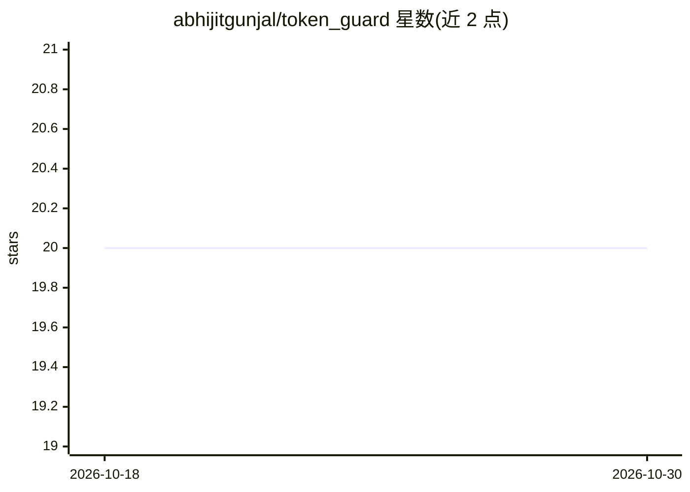

# abhijitgunjal/token_guard

⭐ 20 · Python · MIT · 推送 2026-08-11 · [GitHub](https://github.com/abhijitgunjal/token_guard) · [官网](https://pypi.org/project/llm-token-guard/) · 个人维护

**面向开发者的 LLM token 计量、限流与预算告警中间件**

Python 库 token_guard：记录 LLM API 调用的精确 token 用量，按策略引擎执行滑动窗口、令牌桶、成本、配额、角色等限流，超限时触发 Console/Slack/Webhook 告警。统一支持 OpenAI、Groq、OpenRouter、AWS Bedrock 的计数（tiktoken/HuggingFace/Bedrock API），存储可插拔（内存/Redis/SQLite/PostgreSQL/DynamoDB），提供同步与异步（AsyncTokenGuard）接口，适配 FastAPI/Starlette 等 Web 框架。要求 Python 3.10+，MIT 许可。

## 筛选速览

| 维度 | 判定 | 备注 |
|---|---|---|
| AI 角色 | `ai-ecosystem` | LLM/agent 周边工具 |
| 许可风险 | `permissive` | MIT |
| 部署形态 | `library` | 以包/库形式分发 |
| 模型依赖 | locked-api |  |
| 硬件要求 | — | 无带数字的原话,不猜 |
| 安装摩擦 | `low` | 无编译、无系统依赖或容器化 |
| 成熟度 | — | 结构信号不足 |

## 能力要点

- 7 类限流策略：滑动窗口、令牌桶、固定窗口、漏桶、成本、配额、角色
- 多供应商统一计数：OpenAI/Groq/OpenRouter/AWS Bedrock，支持精确与估算模式
- 可插拔存储：InMemory/Redis/SQLite/PostgreSQL/DynamoDB，一行配置切换
- 同步与全异步入口点，非阻塞 Web 服务器集成

## 适用场景

- 给我的 LLM 应用按用户/模型/会话设置成本上限和配额
- 在请求进入 LLM API 前做限流，避免费用激增和上游限速错误
- 预算或限额被突破时通过 Slack/Webhook 收到实时告警

## 场景标签

`LLM 可观测性` · 领域:评测与运维

## 证据(README 行号)

> L5: Production-ready token tracking, policy evaluation engines, budget limits, and alerts for LLM applications.
> L40: **TokenGuard** operates as a lightweight, thread-safe, and event-loop-safe middleware layer:
> L44: * **Unified Multi-Provider Support**: Track token metrics across OpenAI, Groq, OpenRouter, and AWS Bedrock under a 

## 星数曲线

2026-10-18 20 → 2026-10-30 20（+0）

---
*卡片 v1 · prompt 1.4 · 生成 2026-10-28 · 置信度 high · 依据 README sha `5693e64731c5` · [字段定义](../../DATASET.md)*
