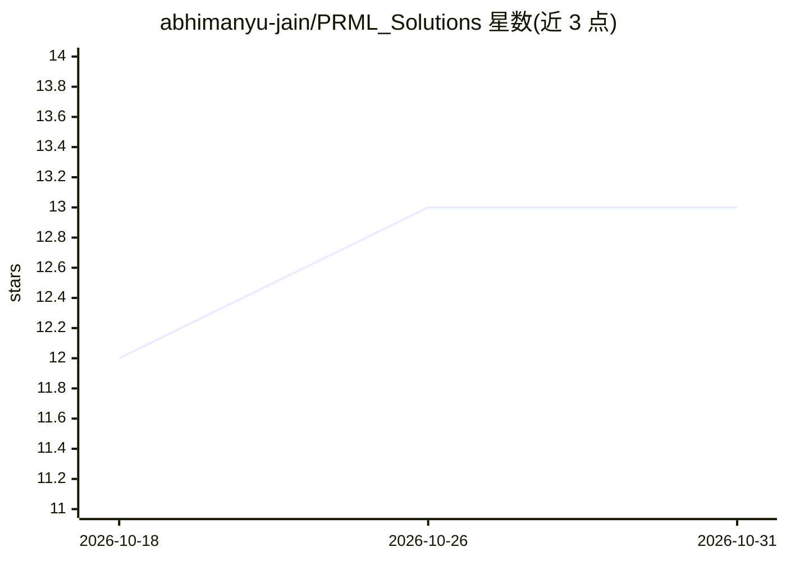

# abhimanyu-jain/PRML_Solutions

⭐ 13 · 推送 2026-09-23 · [GitHub](https://github.com/abhimanyu-jain/PRML_Solutions) · 个人维护

**PRML 教材全部习题的个人解答仓库**

个人学习性质的习题解答集：逐步提交 Bishop《Pattern Recognition and Machine Learning》各章节习题的解答，README 以更新日志形式记录每次提交覆盖的习题编号与缺失项，目前已推进到第六章。解答中引用 Mathematics for Machine Learning 的相同习题解答以避免重复，并直接采用 Matrix Cookbook 的结果并给出具体出处。仓库以 Markdown/文档形式提供，供正在研读该书的学习者参考。

## 筛选速览

| 维度 | 判定 | 备注 |
|---|---|---|
| AI 角色 | `ai-knowledge` | 知识聚合/清单类 |
| 许可风险 | `none` | — |
| 部署形态 | `None` |  |
| 模型依赖 | — | README 未给出锁定关系 |
| 硬件要求 | — | 无带数字的原话,不猜 |
| 安装摩擦 | `low` | 无编译、无系统依赖或容器化 |
| 成熟度 | — | 结构信号不足 |

## 能力要点

- 覆盖 PRML 第 1-6 章大部分习题解答，日志列明各章缺失题号
- 与 Mathematics for Machine Learning 相同习题直接引用避免重复
- 采用 Matrix Cookbook 结果并附具体引用

## 适用场景

- 自学 PRML 时对照检查自己的习题解答
- 查找特定章节习题的参考解法

## 场景标签

`教程课程` · 领域:学习与行业

## 证据(README 行号)

> L3: This repository contains my solutions to all the exercises in the book "Pattern Recognition and Machine Learning" by
> L7: Solutions to some exercises from Chapter 1 committed. Missing Solutions to : 1.15, 1.16, 1.20, 1.23, 1.24, 1.27, 1.2

## 星数曲线

2026-10-18 12 → 2026-10-31 13（+1）

---
*卡片 v1 · prompt 1.4 · 生成 2026-10-31 · 置信度 high · 依据 README sha `35b2b8e3f599` · [字段定义](../../DATASET.md)*
