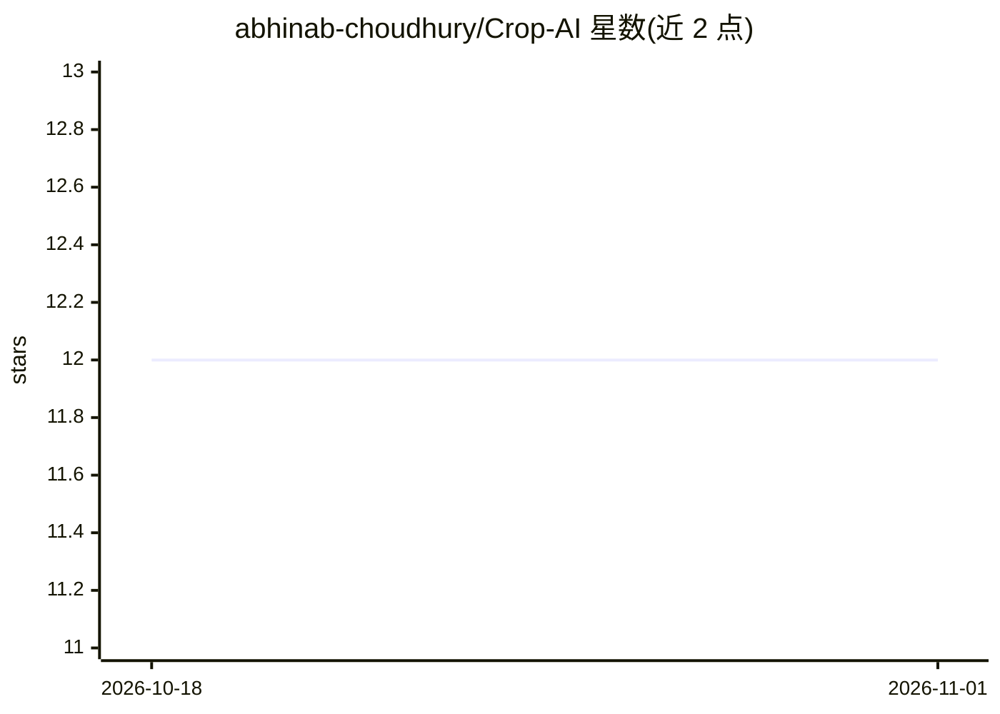

# abhinab-choudhury/Crop-AI

⭐ 12 · Jupyter Notebook · 推送 2026-10-24 · [GitHub](https://github.com/abhinab-choudhury/Crop-AI) · [官网](https://deepwiki.com/abhinab-choudhury/Crop-AI) · 个人维护

**面向农民的作物病害诊断与多语言离线 AI 助手应用**

SIH 2025 黑客松项目的全栈农业平台：移动端（React Native + Expo）提供拍照植物病害检测（ONNX ResNet9，38 类）、Qwen 2.5 0.5B/1.5B 端内对话与 Qwen 2.5-VL 3B 视觉理解，一次性下载模型后可完全离线运行；支持英语/印地语/孟加拉语/泰米尔语回复切换。后端含 Express + MongoDB 与 FastAPI ML 服务器（云端检测回退、XGBoost 作物推荐），以 TurboRepo monorepo 组织，Android APK 经 GitHub Actions 构建发布。

## 筛选速览

| 维度 | 判定 | 备注 |
|---|---|---|
| AI 角色 | `ai-native` | 本体是模型或模型工具 |
| 许可风险 | `none` | — |
| 部署形态 | `desktop` | 安装包/桌面程序 |
| 模型依赖 | local-ok | 支持本地模型 |
| 硬件要求 | — | 无带数字的原话,不猜 |
| 安装摩擦 | `low` | 无编译、无系统依赖或容器化 |
| 成熟度 | — | 结构信号不足 |

## 能力要点

- 端内 LLM（Qwen 2.5 经 llama.rn）+ ONNX 病害检测，一次性下载后离线可用
- 38 类植物病害检测，含断点续传的模型下载
- 四种语言（英/印地/孟加拉/泰米尔语）回复切换
- 云端 FastAPI ML 服务器回退与 XGBoost 作物推荐/产量预测

## 适用场景

- 农民拍照识别作物病害并获得建议
- 网络不佳地区离线使用 AI 问答与病害诊断
- 按所在地区获取多语言农业指导

## 场景标签

`AI 助手` `目标检测` · 领域:对话与助手

## 证据(README 行号)

> L26: - 🌱 **Plant disease detection** — from a photo of a leaf
> L27: - 💬 **Conversational AI chat** — including fully **offline / on-device** after a one-time download
> L46: > (`llama.rn` for the Qwen LLM + ONNX Runtime for disease detection), so chat,

## 星数曲线

2026-10-18 12 → 2026-11-01 12（+0）

---
*卡片 v1 · prompt 1.4 · 生成 2026-11-01 · 置信度 mid · 依据 README sha `7e581826d4ab` · [字段定义](../../DATASET.md)*
