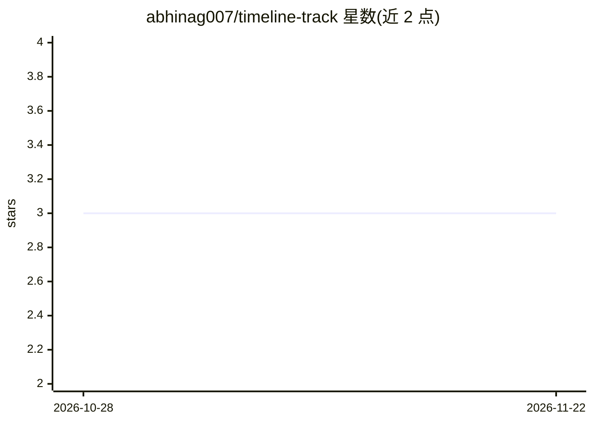

# abhinag007/timeline-track

⭐ 3 · TypeScript · MIT · 推送 2026-10-28 · [GitHub](https://github.com/abhinag007/timeline-track) · [官网](https://timeline-track-inky.vercel.app) · 个人维护

**开发者日志工具：每日一段随笔，Claude 生成结构化时间线**

面向开发者的日志应用：每天输入一段非结构化的当日记录，由 Claude 拆分为已完成事项、待办与事件，并附类别、项目与路线图步骤标签，据此生成时间线、项目历史与学习路线图进度。基于 Next.js 16、Neon Postgres 与 Anthropic API 构建，AI 提议的条目在保存前均可编辑。需自备 Anthropic API key 与 Neon 数据库，无公开注册，需脚本创建账号；提供 Vercel 部署路径与 MIT 许可。

## 筛选速览

| 维度 | 判定 | 备注 |
|---|---|---|
| AI 角色 | `ai-native` | 本体是模型或模型工具 |
| 许可风险 | `permissive` | MIT |
| 部署形态 | `library` | 以包/库形式分发 |
| 模型依赖 | locked-api |  |
| 硬件要求 | — | 无带数字的原话,不猜 |
| 安装摩擦 | `low` | 无编译、无系统依赖或容器化 |
| 成熟度 | — | 结构信号不足 |

## 能力要点

- Claude 将每日段落拆分为已完成/待办/事件并打标签
- 粘贴或上传 .md/.txt/.pdf 计划，生成含阶段与清单的路线图
- GitHub 风格活动热图、连续记录与 7/30/90 天视图
- Markdown 导出与可安装 PWA

## 适用场景

- 记录个人 side project 与开源工作的每日进展
- 把学习计划转为路线图并用日志自动勾销步骤
- 按项目查看历史、开放事项与里程碑

## 场景标签

`知识库管理` `文档解析` · 领域:知识与检索

## 证据(README 行号)

> L3: **A dev log that writes itself.** At the end of the day, type one messy paragraph about what you did. Claude splits 
> L13: Built with Next.js 16, Neon Postgres, Tailwind CSS v4 and the Anthropic API (Claude Opus 5.5). Open source under th

## 星数曲线

2026-10-28 3 → 2026-11-22 3（+0）

---
*卡片 v1 · prompt 1.4 · 生成 2026-11-22 · 置信度 high · 依据 README sha `adfec6f24c69` · [字段定义](../../DATASET.md)*
