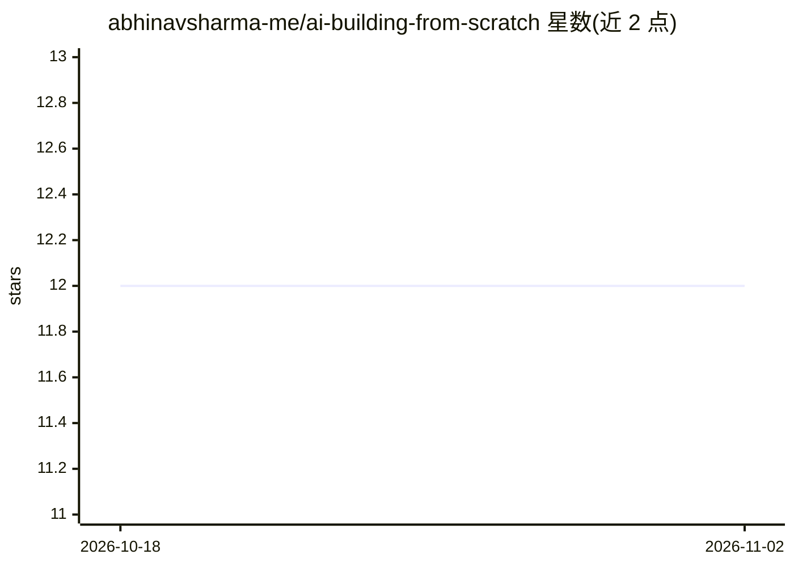

# abhinavsharma-me/ai-building-from-scratch

⭐ 12 · MIT · 推送 2026-02-19 · [GitHub](https://github.com/abhinavsharma-me/ai-building-from-scratch) · 个人维护

**AI 系统构建学习资源清单：从基础到 Agent、AI IDE 与检索**

一个策展式学习清单仓库，按主题组织 AI 系统的构建路径：新兴趋势（OpenClaw、NanoBot）、六类 AI Agent（CLI、ReAct 推理循环、云端异步、多 Agent 编排、自主 Agent、评测安全）、开发工具与 AI IDE（Copilot 原理、Prompt 工具链、Agent 仪表盘、Notebook 集成）、检索与记忆（Word2Vec、向量数据库、RAG、Agent 记忆）。每节条目由 GitHub 仓库、文章、视频、Notebook 与论文组成，并附要点说明；面向希望理解 AI 系统内部机制的开发者，仓库本身无可安装代码。

## 筛选速览

| 维度 | 判定 | 备注 |
|---|---|---|
| AI 角色 | `ai-knowledge` | 知识聚合/清单类 |
| 许可风险 | `permissive` | MIT |
| 部署形态 | `None` |  |
| 模型依赖 | — | README 未给出锁定关系 |
| 硬件要求 | — | 无带数字的原话,不猜 |
| 安装摩擦 | `low` | 无编译、无系统依赖或容器化 |
| 成熟度 | — | 结构信号不足 |

## 能力要点

- 按 6 类 Agent 主题（CLI/ReAct/云端/多Agent/自主/评测）组织条目
- 覆盖 AI IDE、Prompt 工具链、Agent 仪表盘等开发工具方向
- 检索与记忆部分收录 Word2Vec、向量数据库、RAG 原始论文与实现
- 条目类型含 GitHub 仓库、文章、YouTube 视频、Notebook、研究论文

## 适用场景

- 按主题系统学习 AI Agent 从零实现的路径
- 查找 ReAct 循环、多 Agent 编排、评测等主题的参考仓库与论文
- 了解 RAG 与向量检索的原始资料和从零实现示例

## 场景标签

`精选清单` `教程课程` · 领域:学习与行业

## 证据(README 行号)

> L4: This repo is a collection of How AI systems are built from core foundations to models, AI agents, AI IDEs, and emerg
> L8: ### Table of Contents

## 星数曲线

2026-10-18 12 → 2026-11-02 12（+0）

---
*卡片 v1 · prompt 1.4 · 生成 2026-11-01 · 置信度 high · 依据 README sha `dbc272fd2e1a` · [字段定义](../../DATASET.md)*
