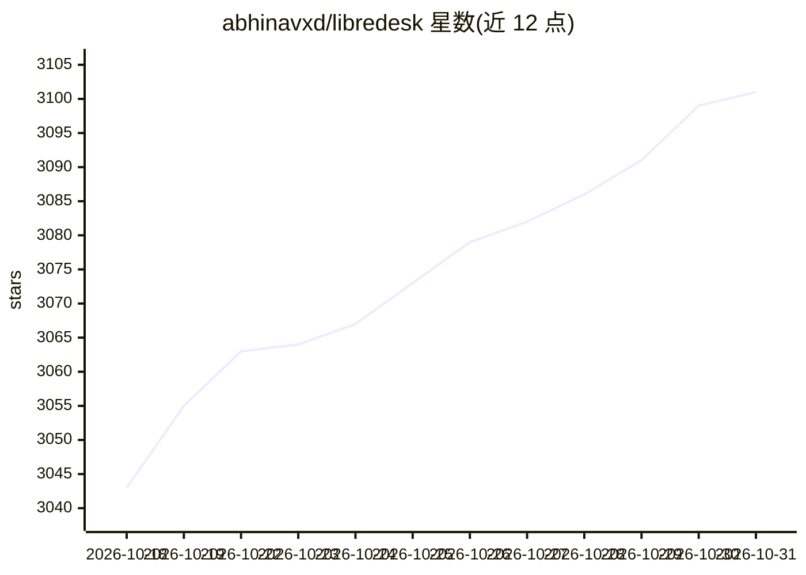

# abhinavxd/libredesk

⭐ 3,101 · Go · AGPL-3.0 · 推送 2026-10-30 · [GitHub](https://github.com/abhinavxd/libredesk) · [官网](https://libredesk.io) · 个人维护

**开源自托管客服系统：单二进制提供邮件/在线聊天/WhatsApp 工单**

以单个二进制分发的自托管客服支持软件，覆盖共享收件箱（邮件、在线聊天、WhatsApp via Meta Cloud API）、可发布多语言知识库的帮助中心、规则自动化、宏、自动分配、SLA、CSAT 与分析、角色权限/SSO、API 与 webhook。AI 为功能模块：基于自有知识库回答聊天提问并在需要时转人工的 AI 助手，以及在收件箱内起草回复、总结会话的 Agent copilot。后端 Go、前端 Vue.js 3，提供 Railway 一键部署、Docker 与二进制三种安装方式，依赖 Postgres 与 Redis。

## 筛选速览

| 维度 | 判定 | 备注 |
|---|---|---|
| AI 角色 | `ai-enhanced` | 去掉 AI 部分产品仍成立 |
| 许可风险 | `viral` | AGPL-3.0 |
| 部署形态 | `None` |  |
| 模型依赖 | — | README 未给出锁定关系 |
| 硬件要求 | — | 无带数字的原话,不猜 |
| 安装摩擦 | `low` | 无编译、无系统依赖或容器化 |
| 成熟度 | — | 结构信号不足 |

## 能力要点

- 单二进制分发，含邮件/在线聊天/WhatsApp 共享收件箱
- AI 助手基于知识库回答聊天并可转人工，copilot 支持起草回复与会话总结
- 自动化规则、宏、自动分配、SLA 与 CSAT 分析
- 角色权限、SSO（Google/Microsoft/OIDC）、API 与 webhook

## 适用场景

- 团队在一处处理邮件、网站聊天与 WhatsApp 客服会话
- 搭建带多语言知识库的自托管帮助中心
- 用自动化规则与 SLA 管理工单分配和响应时效

## 场景标签

`聊天机器人` · 领域:对话与助手

## 证据(README 行号)

> L14:  Open source, self-hosted customer support software for email, live chat, and WhatsApp. Distributed as a single bin
> L32: - **AI assistant:** Answer live chat questions using your knowledge base and hand conversations to an agent when ne
> L33: - **Agent copilot:** Draft replies, summarize conversations, and find answers without leaving the inbox.

## 星数曲线

2026-10-18 3,043 → 2026-10-31 3,101（+58）

---
*卡片 v1 · prompt 1.4 · 生成 2026-10-20 · 置信度 high · 依据 README sha `be1142df511f` · [字段定义](../../DATASET.md)*
