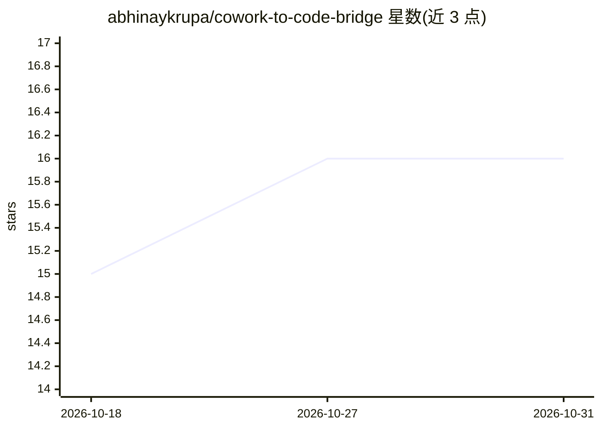

# abhinaykrupa/cowork-to-code-bridge

⭐ 16 · Python · MIT · 推送 2026-10-08 · [GitHub](https://github.com/abhinaykrupa/cowork-to-code-bridge) · [官网](https://github.com/abhinaykrupa/cowork-to-code-bridge#install--two-pastes-total) · 个人维护

**让云端 Claude Cowork 通过 Claude Code 在本机执行任务的桥接工具**

连接 Claude Cowork（云端沙箱）与用户本机 Claude Code 的桥接守护进程：Cowork 将任务写入共享文件夹，本机 daemon（launchd/systemd 管理）调用白名单脚本交给 Claude Code 执行，结果流回聊天。不开放网络端口，以密钥令牌鉴权，只运行用户批准的脚本，支持幂等键避免重复执行。适用于 macOS、Linux 与 WSL2（原生 Windows 不支持）。提供 curl 一键安装、Homebrew 与 pip（从 GitHub）安装方式，另可与 Hermes、cron、CI/CD 集成。

## 筛选速览

| 维度 | 判定 | 备注 |
|---|---|---|
| AI 角色 | `ai-ecosystem` | LLM/agent 周边工具 |
| 许可风险 | `permissive` | MIT |
| 部署形态 | `library` | 以包/库形式分发 |
| 模型依赖 | — | README 未给出锁定关系 |
| 硬件要求 | — | 无带数字的原话,不猜 |
| 安装摩擦 | `low` | 无编译、无系统依赖或容器化 |
| 成熟度 | — | 结构信号不足 |

## 能力要点

- 共享文件夹 + 本机 daemon 的无端口桥接机制
- 只运行白名单脚本，密钥令牌鉴权，无 sudo
- 幂等键缓存结果，重试不重复执行
- launchd/systemd 守护进程，重启自动恢复

## 适用场景

- 从浏览器里的 Claude Cowork 聊天驱动本机 Claude Code 干活
- 让云端 Claude 在我电脑上跑测试、构建应用、推送代码
- 通过 cron/CI/daemon 远程触发本机已批准的脚本

## 场景标签

`编码 Agent` `工作流自动化` · 领域:效率与自动化

## 证据(README 行号)

> L21: This bridge connects the two. Cowork hands a task to **Claude Code on your machine**, a real local agent does the w
> L109: Cowork can't reach your machine directly (it's sandboxed). So the bridge uses a folder both sides can see: Cowork 
> L125: |**`run_claude.sh`**|Your machine|Hands the task to a real **Claude Code** agent — that's what builds the actual p

## 星数曲线

2026-10-18 15 → 2026-10-31 16（+1）

---
*卡片 v1 · prompt 1.4 · 生成 2026-10-30 · 置信度 mid · 依据 README sha `00ed9a9e1928` · [字段定义](../../DATASET.md)*
