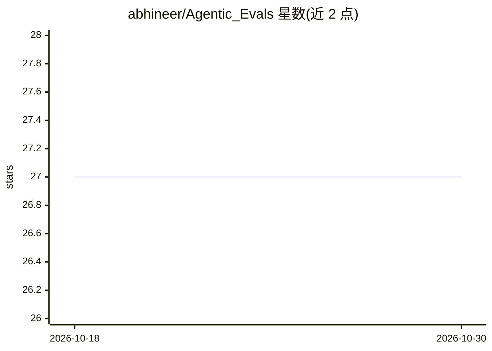

# abhineer/Agentic_Evals

⭐ 27 · Jupyter Notebook · MIT · 推送 2026-08-27 · [GitHub](https://github.com/abhineer/Agentic_Evals) · 个人维护

**面向生产级 AI agent 的评测技术笔记本与示例集**

收录 7 个自包含、可直接在 Google Colab 运行的评测笔记本，覆盖提示词评测、工具调用精度/成功率与成本、RAG 上下文相关性与答案忠实度、规划推理、记忆回忆准确度、合成数据生成与错误分析等维度。评测理念强调闭环：不输出单一分数，而是通过失败分类与生产轨迹回流改进 agent。默认依赖 Groq API key 运行，附 pip 安装命令，本地需 Python 3.8+；Tool Use Benchmark（约 100 任务）尚在开发中。

## 筛选速览

| 维度 | 判定 | 备注 |
|---|---|---|
| AI 角色 | `ai-ecosystem` | LLM/agent 周边工具 |
| 许可风险 | `permissive` | MIT |
| 部署形态 | `library` | 以包/库形式分发 |
| 模型依赖 | locked-api |  |
| 硬件要求 | — | 无带数字的原话,不猜 |
| 安装摩擦 | `low` | 无编译、无系统依赖或容器化 |
| 成熟度 | — | 结构信号不足 |

## 能力要点

- 7 个自包含 Colab-ready 评测笔记本，含指标、数据集与方法论
- 覆盖 RAG、工具调用、规划、记忆、成本、延迟等 8 类评测对象
- 评测-错误分析-改进-重评的闭环方法论与失败分类流程
- 基于维度生成多样化合成评测数据集的笔记本

## 适用场景

- 评估自建 agent 的工具选择与调用是否达到生产标准
- 对比不同检索配置下 RAG 答案的忠实度与正确性
- 系统性归类 agent 失败模式并针对性改进提示词

## 场景标签

`模型评测` · 领域:评测与运维

## 证据(README 行号)

> L3: Practical evaluation techniques, benchmarks, and examples for production AI agents.
> L34: Currently, the repository includes hands-on evaluation notebooks for:

## 星数曲线

2026-10-18 27 → 2026-10-30 27（+0）

---
*卡片 v1 · prompt 1.4 · 生成 2026-10-27 · 置信度 mid · 依据 README sha `77f04828e61f` · [字段定义](../../DATASET.md)*
