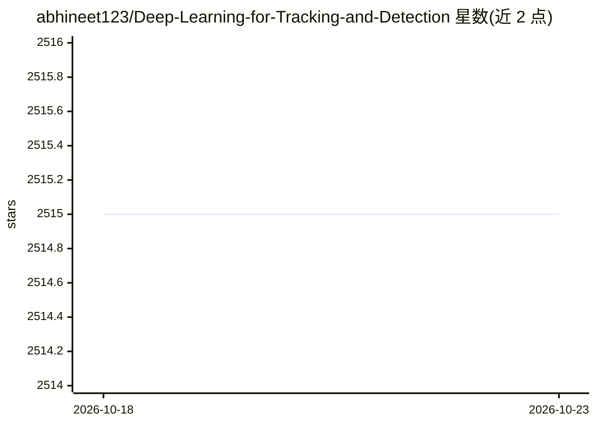

# abhineet123/Deep-Learning-for-Tracking-and-Detection

⭐ 2,515 · HTML · 推送 2026-03-09 · [GitHub](https://github.com/abhineet123/Deep-Learning-for-Tracking-and-Detection) · 个人维护

**深度学习目标检测与跟踪的论文/代码资源合集**

个人维护的计算机视觉资源策展仓库：按静态检测（Region Proposal、RCNN、YOLO、SSD、RetinaNet、Anchor Free）、视频检测（Tubelet、FGFA、RNN）等类别组织目标检测与跟踪论文，条目附 PDF、arXiv、笔记及第三方实现代码链接。另提供 DavidRM Journal 格式的研究数据导出文件（含标签化论文/教程/代码收藏），需 Journal 8 导入使用。仓库本体不提供可运行代码。

## 筛选速览

| 维度 | 判定 | 备注 |
|---|---|---|
| AI 角色 | `ai-knowledge` | 知识聚合/清单类 |
| 许可风险 | `none` | — |
| 部署形态 | `library` | 以包/库形式分发 |
| 模型依赖 | — | README 未给出锁定关系 |
| 硬件要求 | — | 无带数字的原话,不猜 |
| 安装摩擦 | `medium` | 含编译或系统依赖之一 |
| 成熟度 | — | 结构信号不足 |

## 能力要点

- 按算法家族分类组织检测/跟踪论文（RCNN、YOLO、SSD、Anchor Free、视频检测等）
- 多数条目附 PDF、个人笔记与第三方实现链接
- 附带 Journal 格式的标签化研究数据导出文件

## 适用场景

- 查找目标检测/跟踪方向的经典论文与代码实现
- 按算法类别浏览计算机视觉研究脉络
- 导入 Journal 研究数据文件获取标签化的论文与教程收藏

## 场景标签

`精选清单` · 领域:学习与行业

## 证据(README 行号)

> L1: Collection of papers, datasets, code and other resources for object detection and tracking using deep learning
> L29: # Papers

## 星数曲线

2026-10-18 2,515 → 2026-10-23 2,515（+0）

---
*卡片 v1 · prompt 1.4 · 生成 2026-10-21 · 置信度 mid · 依据 README sha `459ea12408b4` · [字段定义](../../DATASET.md)*
