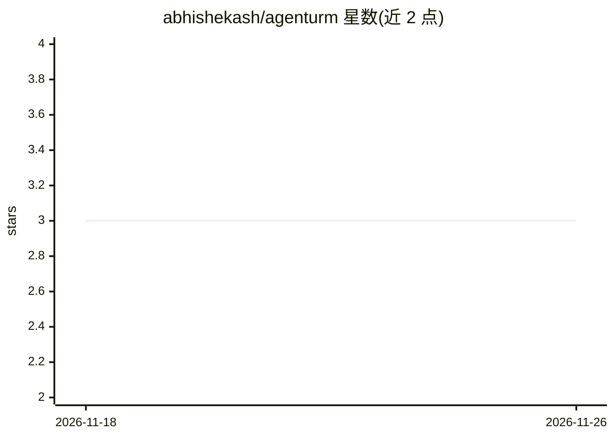

# abhishekash/agenturm

⭐ 3 · Python · MIT · 推送 2026-11-25 · [GitHub](https://github.com/abhishekash/agenturm) · [官网](https://www.agenturm.dev) · 个人维护

**本地终端优先的编程 agent 监控工具：查看每个 agent 请求与调用记录**

Agenturm 读取本地受支持的编程 agent 记录与配置的 OpenTelemetry 信号，存入 SQLite，在终端中提供并发 agent 的归属、请求收件箱、MCP 调用与链路检查、Review 证据审阅、跨会话任务保存与 Handoff 导出（Markdown+HTML）。它只监控，不启动或控制 agent；回复与审批仍在 agent 原生终端完成。需 Python 3.11+，无账号、订阅或 provider API key 即可本地监控；AI 摘要为可选功能，需显式请求。

## 筛选速览

| 维度 | 判定 | 备注 |
|---|---|---|
| AI 角色 | `ai-ecosystem` | LLM/agent 周边工具 |
| 许可风险 | `permissive` | MIT |
| 部署形态 | `library` | 以包/库形式分发 |
| 模型依赖 | — | README 未给出锁定关系 |
| 硬件要求 | — | 无带数字的原话,不猜 |
| 安装摩擦 | `low` | 无编译、无系统依赖或容器化 |
| 成熟度 | — | 结构信号不足 |

## 能力要点

- 本地发现 Codex、Claude Code、OpenCode、Pi、Kiro 的近期记录，无需重启 agent
- 内置接收器默认 127.0.0.1:14318，遥测默认本地状态目录并带 14 天保留
- 捕获 MCP 参数、响应、时长及关联 trace，支持父子 worker 树归属
- 任务保存、决策记录与 Handoff 预览，可导出 Markdown + HTML

## 适用场景

- 同时运行多个编码 agent 时找出哪个请求需要我响应
- 审阅 agent 报告完成前的检查、错误与后续编辑记录
- 排查一次失败的 MCP 工具调用
- 把当前任务与证据交接给另一个会话的 agent

## 场景标签

`LLM 可观测性` · 领域:评测与运维

## 证据(README 行号)

> L2:  Agenturm — Know what your agents are doing. Local observability for coding agents.
> L25: Agenturm reads supported local agent records and configured OpenTelemetry signals into SQLite. Its practical value 
> L67: Agenturm starts or attaches to its local receiver. Recent supported **Codex, Claude Code, OpenCode, Pi, and Kiro** 

## 星数曲线

2026-11-18 3 → 2026-11-26 3（+0）

---
*卡片 v1 · prompt 1.4 · 生成 2026-11-22 · 置信度 high · 依据 README sha `bcc77a1326de` · [字段定义](../../DATASET.md)*
