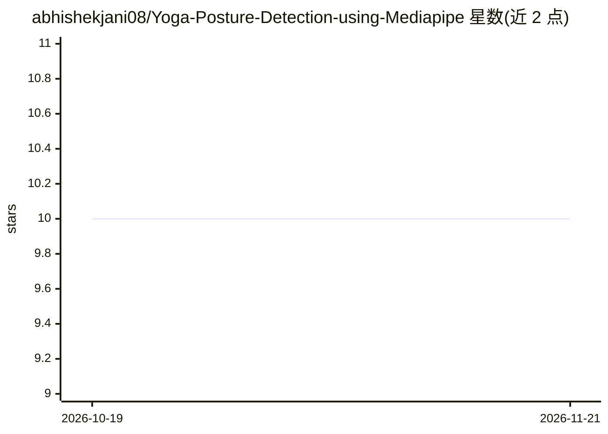

# abhishekjani08/Yoga-Posture-Detection-using-Mediapipe

⭐ 10 · Jupyter Notebook · 推送 2026-02-09 · [GitHub](https://github.com/abhishekjani08/Yoga-Posture-Detection-using-Mediapipe) · 个人维护

**实时检测瑜伽体式并给出反馈的视觉工具**

基于 MediaPipe 的计算机视觉项目：先对人体图像做骨架化与关键点检测，再输入模型实时识别与分类瑜伽体式，评估关节角度、身体对齐与运动模式，并给出即时纠正反馈与准确率展示。前端使用 React，GUI 使用 OpenCV。README 未提供安装步骤、依赖清单或运行方式，属于演示性质的项目说明。

## 筛选速览

| 维度 | 判定 | 备注 |
|---|---|---|
| AI 角色 | `ai-native` | 本体是模型或模型工具 |
| 许可风险 | `none` | — |
| 部署形态 | `None` |  |
| 模型依赖 | — | README 未给出锁定关系 |
| 硬件要求 | — | 无带数字的原话,不猜 |
| 安装摩擦 | `low` | 无编译、无系统依赖或容器化 |
| 成熟度 | — | 结构信号不足 |

## 能力要点

- MediaPipe 骨架化与人体关键点检测
- 实时体式识别与分类，输出准确率
- 评估关节角度、身体对齐与运动模式

## 适用场景

- 个人瑜伽练习时获得体式实时反馈
- 检测并纠正瑜伽动作姿态

## 场景标签

`目标检测` · 领域:感知与多模态

## 证据(README 行号)

> L2:  The Yoga Posture Detection System is a computer vision-based tool that can automatically identify and monitor the p
> L5: + Mediapipe

## 星数曲线

2026-10-19 10 → 2026-11-21 10（+0）

---
*卡片 v1 · prompt 1.4 · 生成 2026-11-20 · 置信度 high · 依据 README sha `a0e81160df9e` · [字段定义](../../DATASET.md)*
