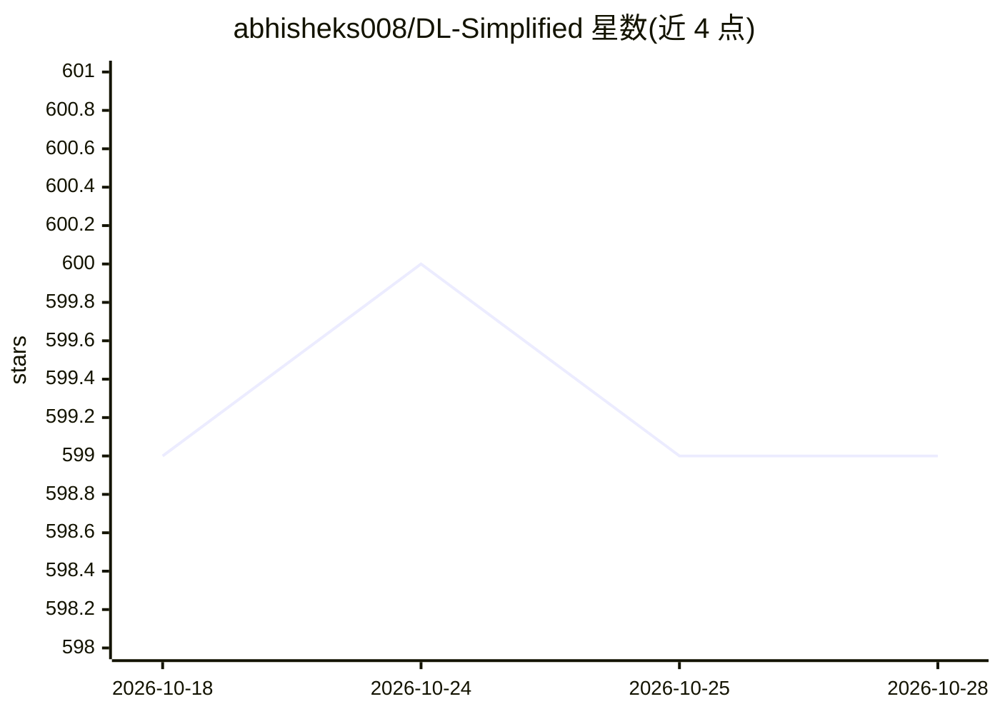

# abhisheks008/DL-Simplified

⭐ 599 · Jupyter Notebook · MIT · 推送 2026-10-23 · [GitHub](https://github.com/abhisheks008/DL-Simplified) · [官网](https://quine.sh/repo/abhisheks008-DL-Simplified-499023976) · 个人维护

**面向贡献者的深度学习入门项目合集仓库**

开放源代码仓库，收录从入门到进进阶的深度学习项目，目标读者是希望开始或深入深度学习的贡献者。仓库规定统一的项目模板：每个项目含 Dataset 文件夹、存放分析/可视化图像的 Images 文件夹，以及包含 .ipynb 项目文件、README 与 requirements.txt 的 Model 文件夹。贡献流程为认领 issue、fork、clone、提交 PR。仓库参与多项开源活动（SSOC、SWOC、GSSoC、HacktoberFest 等），由个人维护者 Abhishek Sharma 管理。

## 筛选速览

| 维度 | 判定 | 备注 |
|---|---|---|
| AI 角色 | `ai-knowledge` | 知识聚合/清单类 |
| 许可风险 | `permissive` | MIT |
| 部署形态 | `None` |  |
| 模型依赖 | — | README 未给出锁定关系 |
| 硬件要求 | — | 无带数字的原话,不猜 |
| 安装摩擦 | `low` | 无编译、无系统依赖或容器化 |
| 成熟度 | — | 结构信号不足 |

## 能力要点

- 收录初学者到进阶级深度学习项目
- 规定统一项目模板（Dataset/Images/Model 三目录结构与 requirements.txt）
- 提供 fork-clone-PR 的贡献工作流说明
- 参与 SSOC/SWOC/GSSoC/HacktoberFest 等多项开源活动

## 适用场景

- 寻找入门级深度学习项目练手或开始贡献之旅
- 按统一模板提交自己的深度学习项目参与开源活动
- 浏览不同层级深度学习项目的数据集与建模流程

## 场景标签

`精选清单` · 领域:学习与行业

## 证据(README 行号)

> L3: Welcome to **Deep Learning Simplified**! 🎉 This open-source repository is a comprehensive collection of deep learnin
> L22: **Deep Learning Simplified is an open-source repository containing beginner to advanced-level deep learning project

## 星数曲线

2026-10-18 599 → 2026-10-28 599（+0）

---
*卡片 v1 · prompt 1.4 · 生成 2026-10-21 · 置信度 high · 依据 README sha `986e9876795c` · [字段定义](../../DATASET.md)*
