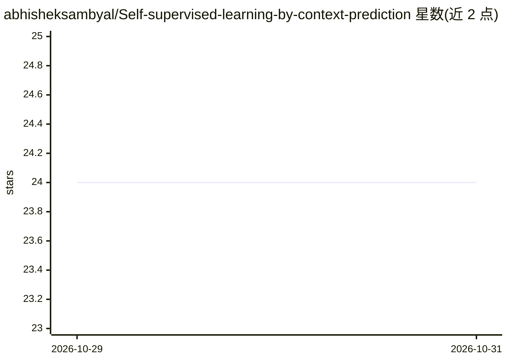

# abhisheksambyal/Self-supervised-learning-by-context-prediction

⭐ 24 · HTML · MIT · 推送 2026-10-28 · [GitHub](https://github.com/abhisheksambyal/Self-supervised-learning-by-context-prediction) · 组织维护

**上下文预测自监督表征学习论文的 PyTorch 复现**

PyTorch 实现论文《Unsupervised Visual Representation Learning by Context Prediction》（Doersch, Gupta, Efros, ICCV 2015）：通过预测图像中相邻补丁的相对位置这一代理任务进行自监督预训练，学习视觉表征。README 提供论文链接，结果以 Jupyter Notebook 及其 HTML 转换文件形式附带展示（GitHub 在线渲染 .ipynb 显示异常，需下载查看）。代码由三名贡献者共同完成。

## 筛选速览

| 维度 | 判定 | 备注 |
|---|---|---|
| AI 角色 | `ai-native` | 本体是模型或模型工具 |
| 许可风险 | `permissive` | MIT |
| 部署形态 | `None` |  |
| 模型依赖 | — | README 未给出锁定关系 |
| 硬件要求 | — | 无带数字的原话,不猜 |
| 安装摩擦 | `low` | 无编译、无系统依赖或容器化 |
| 成熟度 | — | 结构信号不足 |

## 能力要点

- 以补丁相对位置预测为代理任务的自监督学习实现
- 附带结果展示的 Jupyter Notebook 与 HTML 版本

## 适用场景

- 复现 ICCV 2015 上下文预测自监督方法
- 学习自监督预训练的 PyTorch 代码结构
- 验证论文方法获得的视觉表征

## 场景标签

 · 领域:计算机视觉/表征学习

## 证据(README 行号)

> L3: Pytorch Implementation of "Unsupervised Visual Representation Learning by Context Prediction" by C. Doersh, A. Gupta
> L4: ICCV Paper Link: https://www.cv-foundation.org/openaccess/content_iccv_2015/papers/Doersch_Unsupervised_Visual_Repre

## 星数曲线

2026-10-29 24 → 2026-10-31 24（+0）

---
*卡片 v1 · prompt 1.4 · 生成 2026-10-28 · 置信度 mid · 依据 README sha `7793c747f48f` · [字段定义](../../DATASET.md)*
