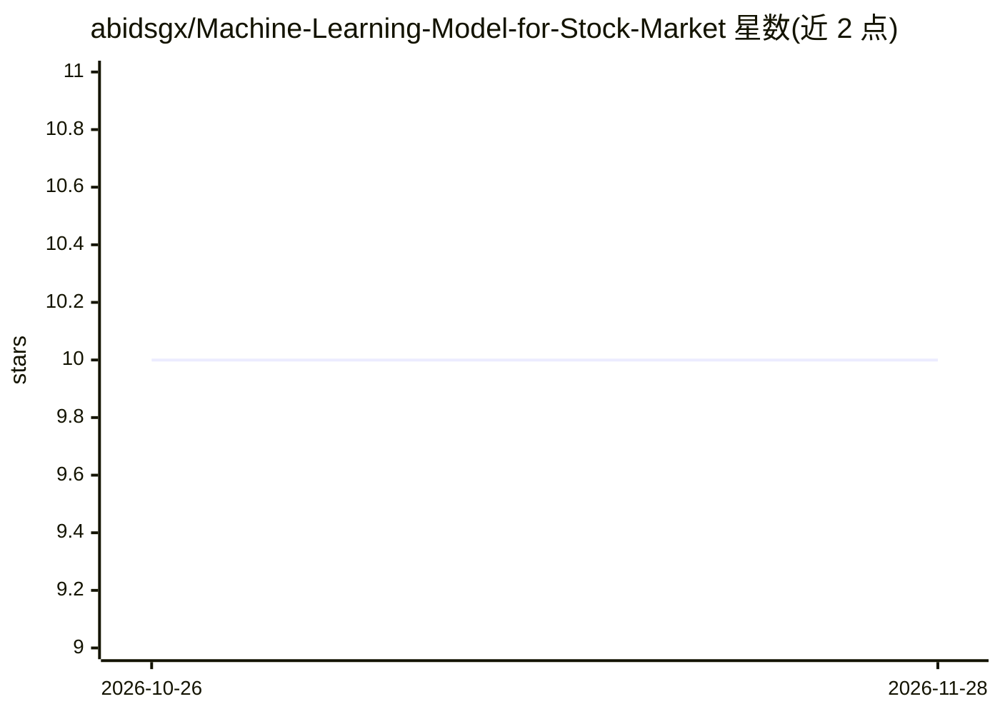

# abidsgx/Machine-Learning-Model-for-Stock-Market

⭐ 10 · Python · AGPL-3.0 · 推送 2026-09-01 · [GitHub](https://github.com/abidsgx/Machine-Learning-Model-for-Stock-Market) · 个人维护

**股票分钟级涨跌预测的分类模型与回测脚本**

提供基于 SGDClassifier 的股票价格分类模型脚本，依据滞后收益率、差分等特征预测下一分钟收盘涨跌；训练后保存模型与指标，回测脚本读取其输出模拟交易表现，并用混淆矩阵、学习曲线、特征权重图与损失曲线四种图表可视化。数据要求为含 OHLCV 列的 CSV，需手动编辑脚本适配列名。作者明确提示勿用于实际交易，并指出分钟级数据难以实时部署。

## 筛选速览

| 维度 | 判定 | 备注 |
|---|---|---|
| AI 角色 | `ai-native` | 本体是模型或模型工具 |
| 许可风险 | `viral` | AGPL-3.0 |
| 部署形态 | `library` | 以包/库形式分发 |
| 模型依赖 | — | README 未给出锁定关系 |
| 硬件要求 | — | 无带数字的原话,不猜 |
| 安装摩擦 | `low` | 无编译、无系统依赖或容器化 |
| 成熟度 | — | 结构信号不足 |

## 能力要点

- SGDClassifier 分钟级涨跌分类模型
- 4 种性能可视化图（混淆矩阵/学习曲线/特征权重/损失曲线）
- 配套回测脚本模拟交易表现

## 适用场景

- 学习用 scikit-learn 对时间序列做分类建模
- 对自己下载的股票 CSV 数据训练并评估模型
- 用回测脚本查看模型的模拟交易曲线

## 场景标签

`金融量化` · 领域:学习与行业

## 证据(README 行号)

> L9: This repository contains a classification model (SGDClassifier) that can be trained and evaluated on time series sto
> L28: The price classification model simply predicts whether the price will close higher or lower in the next minute base

## 星数曲线

2026-10-26 10 → 2026-11-28 10（+0）

---
*卡片 v1 · prompt 1.4 · 生成 2026-11-20 · 置信度 high · 依据 README sha `b05dfeee9cd5` · [字段定义](../../DATASET.md)*
