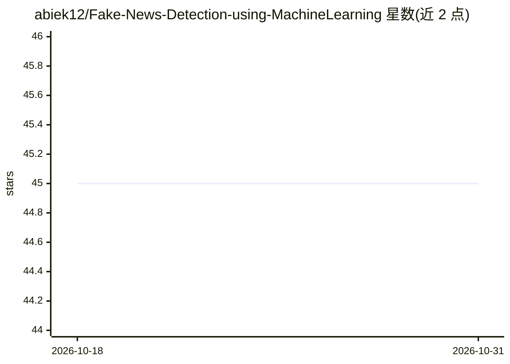

# abiek12/Fake-News-Detection-using-MachineLearning

⭐ 45 · Jupyter Notebook · 推送 2026-08-05 · [GitHub](https://github.com/abiek12/Fake-News-Detection-using-MachineLearning) · 个人维护

**基于机器学习的假新闻检测项目，含 Flask 实时预测 Web 应用**

使用 Passive Aggressive Classifier 与 NLP 技术对新闻文章做真/假二分类的完整项目：以 Kaggle 的 train.csv/test.csv 数据集训练模型，评估准确率为 96%，仓库附带预训练的 model.pkl 与 vector.pkl。分析训练在 Jupyter Notebook 中完成，另提供 Flask Web 应用（app.py），用户访问 http://localhost:5000 提交文本获得实时检测结果。方法论上以来源为单位聚合多篇文章判定，设想用于社交平台的可见性权重调整。运行需 Python 3.7+ 并安装 requirements.txt 依赖。

## 筛选速览

| 维度 | 判定 | 备注 |
|---|---|---|
| AI 角色 | `ai-native` | 本体是模型或模型工具 |
| 许可风险 | `none` | — |
| 部署形态 | `library` | 以包/库形式分发 |
| 模型依赖 | — | README 未给出锁定关系 |
| 硬件要求 | — | 无带数字的原话,不猜 |
| 安装摩擦 | `low` | 无编译、无系统依赖或容器化 |
| 成熟度 | — | 结构信号不足 |

## 能力要点

- Passive Aggressive Classifier 二分类模型，评估准确率 96%
- 提供预训练 model.pkl 与 vector.pkl，可直接预测
- Flask Web 应用支持实时假新闻检测
- 含 Jupyter Notebook 数据分析与模型训练流程

## 适用场景

- 在 Web 界面输入新闻文本，获得真/假分类结果
- 学习假新闻检测的完整流程：数据分析、训练到部署
- 基于来源聚合多篇文章判定其可信度

## 场景标签

`教程课程` · 领域:学习与行业

## 证据(README 行号)

> L6: This repository contains a comprehensive project for detecting fake news using machine learning techniques and vario
> L39: The machine learning model used for fake news detection in this project is the **Passive Aggressive Classifier**.

## 星数曲线

2026-10-18 45 → 2026-10-31 45（+0）

---
*卡片 v1 · prompt 1.4 · 生成 2026-10-25 · 置信度 high · 依据 README sha `74326f84ec00` · [字段定义](../../DATASET.md)*
