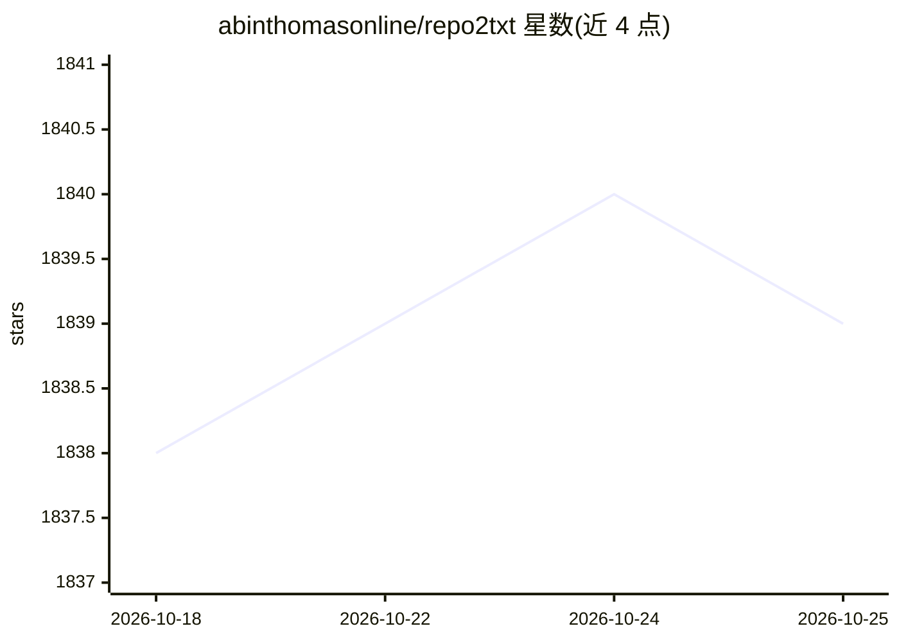

# abinthomasonline/repo2txt

⭐ 1,839 · TypeScript · 推送 2026-10-22 · [GitHub](https://github.com/abinthomasonline/repo2txt) · [官网](https://abinthomas.in/repo2txt/) · 个人维护

**浏览器端把 GitHub/本地代码仓库转成单一文本供 LLM 使用的工具**

纯浏览器运行的 Web 工具：读取 GitHub（含私有仓库，支持 token）、GitLab（Beta）、Azure DevOps（Beta）仓库或本地目录/zip 文件，经扩展名过滤、gitignore、自定义忽略模式与目录挑选后，生成单个格式化文本文件，附带实时 GPT token 计数与文件级统计，可复制或下载为 .txt。所有处理在本地完成，代码不上传服务器。面向需要为 LLM 提示准备代码上下文的开发者，提供在线版与源码运行两种方式。

## 筛选速览

| 维度 | 判定 | 备注 |
|---|---|---|
| AI 角色 | `ai-ecosystem` | LLM/agent 周边工具 |
| 许可风险 | `permissive` | — |
| 部署形态 | `None` |  |
| 模型依赖 | — | README 未给出锁定关系 |
| 硬件要求 | — | 无带数字的原话,不猜 |
| 安装摩擦 | `low` | 无编译、无系统依赖或容器化 |
| 成熟度 | — | 结构信号不足 |

## 能力要点

- 支持 GitHub/GitLab/Azure DevOps 仓库、本地目录与 zip 上传多种来源
- 扩展名过滤、gitignore、自定义忽略模式与目录挑选
- 实时 GPT token 计数与逐文件 token/行数统计
- 100% 浏览器端处理，代码不离开本地设备

## 适用场景

- 把整个或部分代码仓库打包成文本喂给 ChatGPT/Claude 等 LLM
- 在向 AI 提问前估算代码的 token 消耗
- 在不上传代码到服务器的前提下准备 LLM 上下文

## 场景标签

`提示工程` · 领域:Agent 开发

## 证据(README 行号)

> L8: > **Convert repositories to plain text for LLM prompts**
> L44: - **100% Browser-Based** - No server uploads, all processing is local

## 星数曲线

2026-10-18 1,838 → 2026-10-25 1,839（+1）

---
*卡片 v1 · prompt 1.4 · 生成 2026-10-21 · 置信度 high · 依据 README sha `b11ad32cf237` · [字段定义](../../DATASET.md)*
