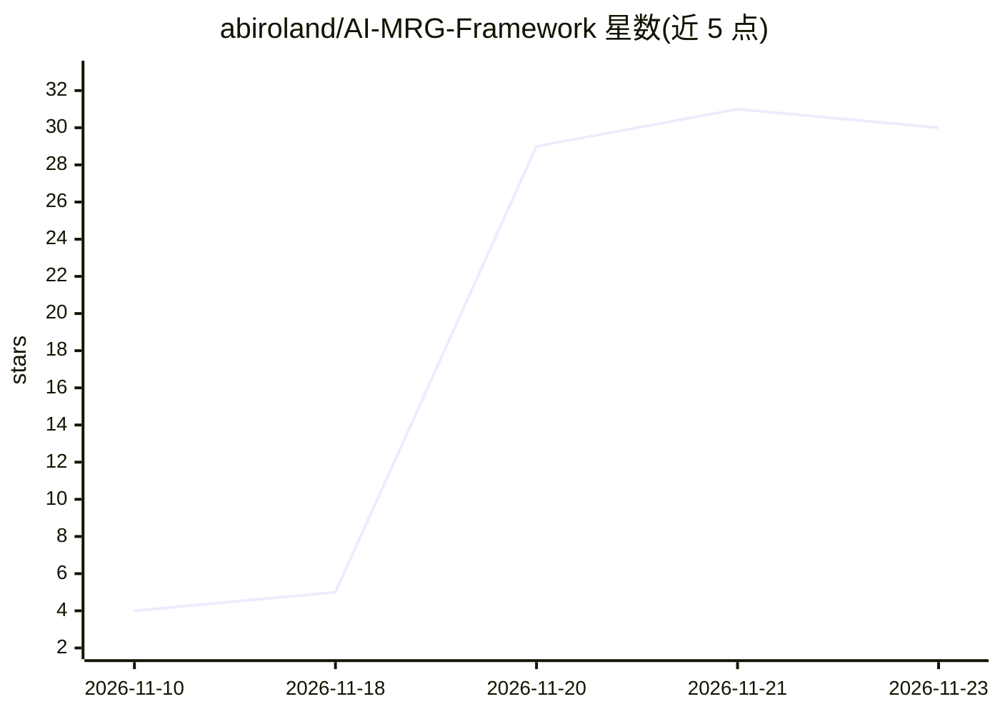

# abiroland/AI-MRG-Framework

⭐ 30 · Python · Apache-2.0 · 推送 2026-11-22 · [GitHub](https://github.com/abiroland/AI-MRG-Framework) · [官网](https://pypi.org/project/ai-mrg/) · 个人维护

**美国银行业 AI/模型风险治理工具包：登记、分级、验证并生成监管证据**

面向美国受监管行业（首期金融服务）的开源全生命周期模型与 AI 治理工具包：登记模型与 AI 系统清单并按 SR 26-2 或 GenAI/agentic 轨道分类，按固有风险做风险分级，运行数据质量、性能、公平放贷与不利行动理由检查，维护哈希链式防篡改证据记录，生成 Markdown/Word 报告；v0.3 提供 Web 仪表盘、REST API、MLflow 集成、PostgreSQL 支持与 Docker Compose 部署。声明非法律意见、非认证、非托管服务，包内容尚未经从业者评审。

## 筛选速览

| 维度 | 判定 | 备注 |
|---|---|---|
| AI 角色 | `ai-ecosystem` | LLM/agent 周边工具 |
| 许可风险 | `permissive` | Apache-2.0 |
| 部署形态 | `self-host` | docker 或自建部署 |
| 模型依赖 | — | README 未给出锁定关系 |
| 硬件要求 | — | 无带数字的原话,不猜 |
| 安装摩擦 | `low` | 无编译、无系统依赖或容器化 |
| 成熟度 | `idea` | |

## 能力要点

- 清单登记、风险分级、控制目录与门禁式生命周期工作流（含独立审批）
- 公平放贷与不利行动理由自动检查库
- 哈希链式防篡改证据链与可验证监管提交包
- Web 仪表盘 + REST API（基于角色访问）+ MLflow/PostgreSQL/Docker Compose

## 适用场景

- 社区银行、信用社或金融科技公司建立模型与 AI 系统清单和风险分级
- 对信贷模型运行公平放贷与不利行动理由检查并留存证据
- 生成映射 SR 26-2、ECOA/Reg B、NIST AI RMF 的验证与监控报告
- 本地自托管治理平台替代按许可证收费的企业产品

## 场景标签

`MLOps` `模型评测` · 领域:评测与运维

## 证据(README 行号)

> L3: **An open-source, full-lifecycle AI and model risk governance toolkit for U.S. regulated industries — starting with 
> L20: AI-MRG turns these sources into **versioned control catalogs, automated checks, evidence trails and document templa
> L29: |**Checks library**|Python checks for data quality, performance, stability, outcomes analysis, fair lending and adv

## 星数曲线

2026-11-10 4 → 2026-11-23 30（+26）

---
*卡片 v1 · prompt 1.4 · 生成 2026-11-20 · 置信度 high · 依据 README sha `eb5c9e9a20ed` · [字段定义](../../DATASET.md)*
