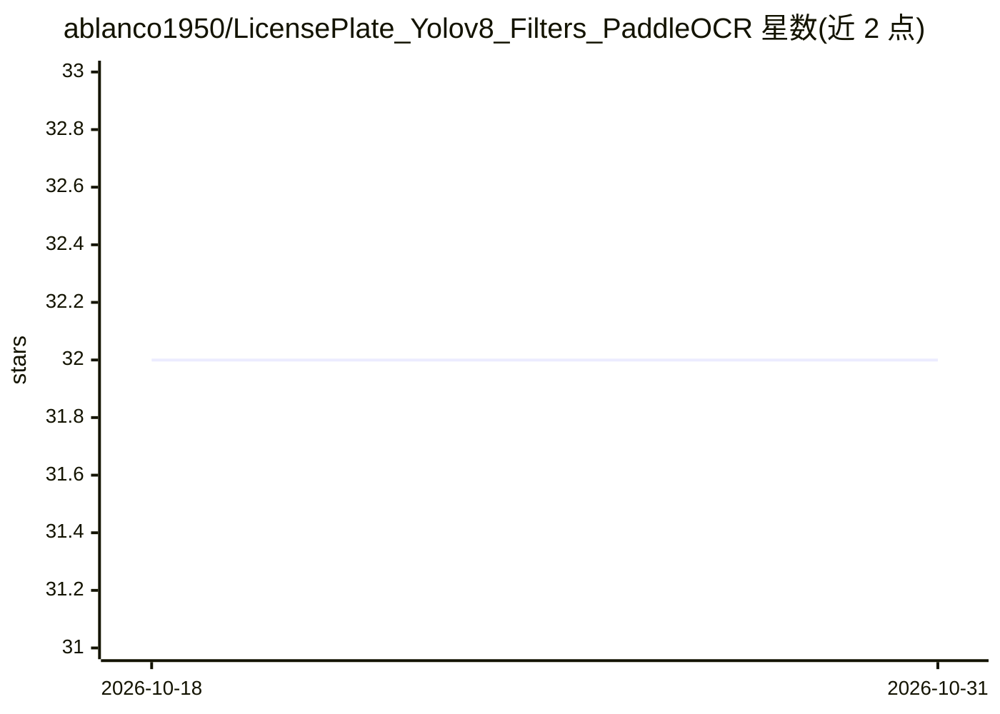

# ablanco1950/LicensePlate_Yolov8_Filters_PaddleOCR

⭐ 32 · Python · NOASSERTION · 推送 2026-08-15 · [GitHub](https://github.com/ablanco1950/LicensePlate_Yolov8_Filters_PaddleOCR) · 个人维护

**YOLOv8+PaddleOCR+滤波管线的车牌识别项目**

识别任意格式车牌号码的计算机视觉项目：用 YOLOv8 检测车牌框，经 FSRCNN 超分、Otsu 阈值等滤波管线处理后由 PaddleOCR 完成 OCR。支持 CPU 运行（GPU 可选 CUDA），提供图像目录测试、视频版识别与汇总统计（车牌号+快照数），附带训练脚本可基于 Roboflow 数据集（245 张图）重新训练 best.pt 模型，并附与其他系统（Doubango、fast-alpr）的对比 Excel 结果。面向计算机视觉/OCR 开发者。

## 筛选速览

| 维度 | 判定 | 备注 |
|---|---|---|
| AI 角色 | `ai-native` | 本体是模型或模型工具 |
| 许可风险 | `none` | NOASSERTION |
| 部署形态 | `desktop` | 安装包/桌面程序 |
| 模型依赖 | — | README 未给出锁定关系 |
| 硬件要求 | — | 无带数字的原话,不猜 |
| 安装摩擦 | `medium` | 含编译或系统依赖之一 |
| 成熟度 | — | 结构信号不足 |

## 能力要点

- YOLOv8 检测 + 滤波管线 + PaddleOCR 的车牌识别流程
- 图像与视频两种运行模式，视频版输出车牌汇总与摘要视频
- 附带 best.pt 模型与训练脚本，可基于 Roboflow 数据集重训
- 随附与 Doubango、Hugging Face fast-alpr 的对比结果 Excel

## 适用场景

- 对图像文件夹批量识别车牌号码
- 从交通摄像头视频中检测并统计车牌
- 学习 YOLOv8+OCR 车牌识别管线的搭建与训练

## 场景标签

`目标检测` `OCR` · 领域:感知与多模态

## 证据(README 行号)

> L2: Recognition of license plate numbers, in any format, by automatic detection with Yolov8, pipeline of filters and pad
> L30: python GetNumberInternationalLicensePlate_Yolov8_Filters_PaddleOCR-VL.py

## 星数曲线

2026-10-18 32 → 2026-10-31 32（+0）

---
*卡片 v1 · prompt 1.4 · 生成 2026-10-26 · 置信度 high · 依据 README sha `879c5b1a5bf9` · [字段定义](../../DATASET.md)*
