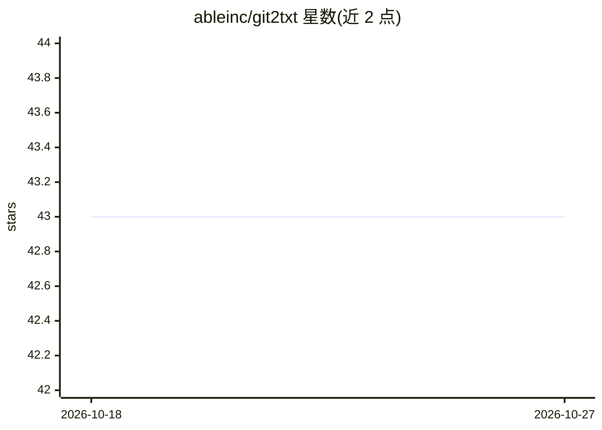

# ableinc/git2txt

⭐ 43 · Python · 推送 2026-07-31 · [GitHub](https://github.com/ableinc/git2txt) · 个人维护

**把 Git 仓库文件转换为 .txt 的 LLM 训练数据准备工具**

Python 命令行工具：读取 .env 中配置的 Git 项目目录，将仓库内全部文件转换为 .txt 文件，输出到指定目录（默认 training_data/），用于在自有代码库上训练 LLM。支持通过环境变量配置忽略文件列表（如 .env、package-lock.json）、忽略目录（如 .git、node_modules）及跳过空文件。安装方式为克隆源码后 pip 安装 requirements.txt 依赖，运行 python main.py。要求 Python 3.6 或更高版本。

## 筛选速览

| 维度 | 判定 | 备注 |
|---|---|---|
| AI 角色 | `ai-ecosystem` | LLM/agent 周边工具 |
| 许可风险 | `none` | — |
| 部署形态 | `library` | 以包/库形式分发 |
| 模型依赖 | — | README 未给出锁定关系 |
| 硬件要求 | — | 无带数字的原话,不猜 |
| 安装摩擦 | `low` | 无编译、无系统依赖或容器化 |
| 成熟度 | — | 结构信号不足 |

## 能力要点

- 将 Git 仓库全部文件转换为 .txt 训练数据
- 可配置忽略文件/目录列表与输出目录
- 支持跳过空文件

## 适用场景

- 把代码库整理成文本用于 LLM 训练
- 批量导出仓库文件内容并排除敏感或无关文件

## 场景标签

`MLOps` · 领域:训练与推理

## 证据(README 行号)

> L3: Convert all files in git repository to .txt files. This is useful for training LLMs on your codebase.
> L16: SAVE_DIRECTORY=training_data

## 星数曲线

2026-10-18 43 → 2026-10-27 43（+0）

---
*卡片 v1 · prompt 1.4 · 生成 2026-10-25 · 置信度 mid · 依据 README sha `ccb22b1868d8` · [字段定义](../../DATASET.md)*
