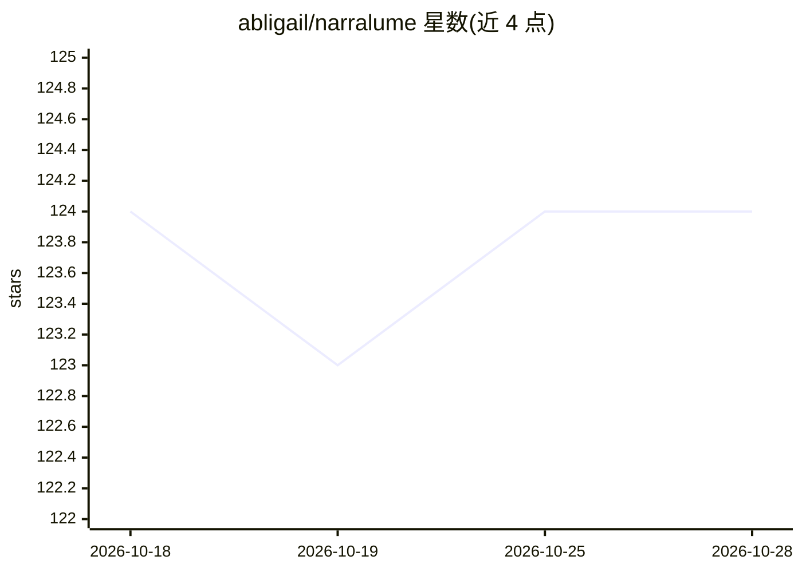

# abligail/narralume

⭐ 124 · TypeScript · Apache-2.0 · 推送 2026-10-22 · [GitHub](https://github.com/abligail/narralume) · [官网](https://app.narralume.me) · 个人维护 · 中文 README

**长篇小说写作工作台：故事设定、AI 协作与审稿交付一体化**

面向长篇小说作者的写作环境：以故事圣经（作者意图、大纲、实体、正典事实、关系、时间线、伏笔）统一组织设定，支持纯手写、选段编辑/章节委托、连续创作三种模式。AI 生成的正文、修订与设定变更先暂存为候选，由作者比较接受或拒绝；与已锁定事实冲突时暂停任务待作者决策。提供导入导出（Markdown/DOCX/EPUB 等）、项目快照与全库 SQLite 备份。界面支持中英文。提供托管 demo、各平台启动器与 Docker Compose 部署方式。

## 筛选速览

| 维度 | 判定 | 备注 |
|---|---|---|
| AI 角色 | `ai-native` | 本体是模型或模型工具 |
| 许可风险 | `permissive` | Apache-2.0 |
| 部署形态 | `self-host` | docker 或自建部署 |
| 模型依赖 | — | README 未给出锁定关系 |
| 硬件要求 | — | 无带数字的原话,不猜 |
| 安装摩擦 | `low` | 无编译、无系统依赖或容器化 |
| 成熟度 | — | 结构信号不足 |

## 能力要点

- 七段式故事圣经统一管理设定，AI 变更以 diff 呈现
- AI 输出均暂存为候选，作者接受后才入稿
- 支持 OpenAI Chat Completions/Responses 与 Anthropic Messages 协议
- 导入导出 Markdown/DOCX/HTML/EPUB，含项目快照与全库备份

## 适用场景

- 长篇小说写作时维护人物、时间线与伏笔的一致性
- 把章节委托给 AI 生成后逐章审阅、接受或拒绝
- 自托管部署写作环境，本地保存书稿数据

## 场景标签

`AI 写作` · 领域:内容生成

## 证据(README 行号)

> L13: NarraLume keeps that work in one writing environment. You can maintain structured story material, write by hand, sa
> L15: It is a complete manual writing tool first and an AI-assisted tool second. Creating books, importing manuscripts, o
> L145: NarraLume supports OpenAI Chat Completions, OpenAI Responses, and Anthropic Messages. Direct browser requests requ

## 星数曲线

2026-10-18 124 → 2026-10-28 124（+0）

---
*卡片 v1 · prompt 1.4 · 生成 2026-10-23 · 置信度 high · 依据 README sha `836c35505e28` · [字段定义](../../DATASET.md)*
