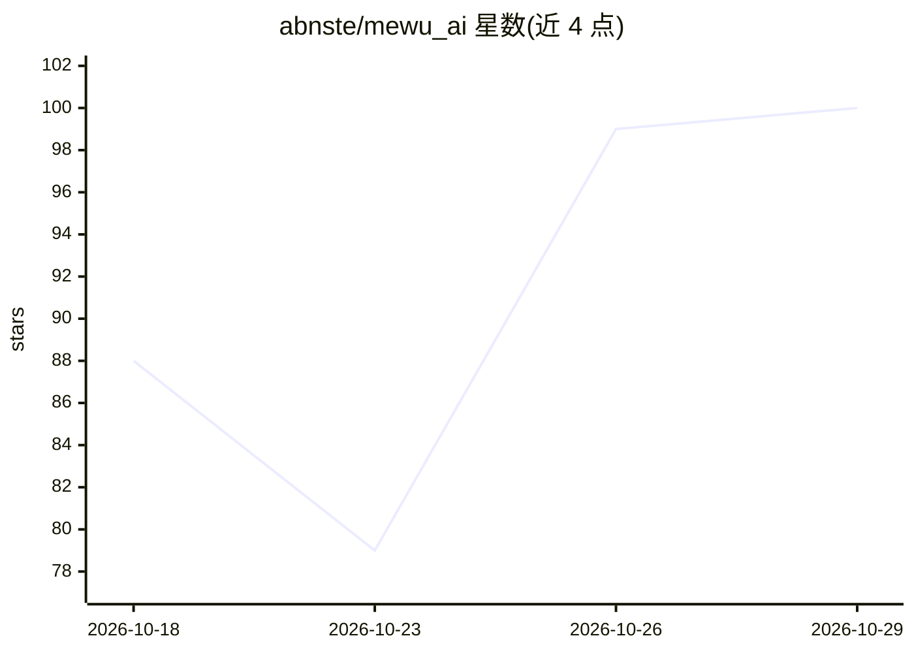

# abnste/mewu_ai

⭐ 100 · Rust · MPL-2.0 · 推送 2026-10-27 · [GitHub](https://github.com/abnste/mewu_ai) · 个人维护 · 中文 README

**跨平台截图/标注/录屏工具，把截图界面作为 AI 对话空间**

面向桌面用户的开源截图与标注工作区：快捷键唤起截图界面，支持区域选择、绘制、贴图、滚动截图、区域录屏与剪辑导出（MP4/MP3/GIF），OCR 本地运行，翻译和表格提取需连接模型服务。截图界面内置对话栏，可引用截图/视频/文件提问，得到可交互的 HTML/SVG/Canvas 结果。可选 Agent、长期记忆（SQLite/FTS5）与权限检查的插件生态（QuickJS 进程运行 API ES Modules，含插件市场与 CLI）。无 AI key 时截图、绘制与录屏功能仍可用。当前版本基于 Rust + Tauri 2 + Solid/TypeScript，旧 Windows .NET/WPF 版本保留在 dotnet 分支；自述仍处于 beta。

## 筛选速览

| 维度 | 判定 | 备注 |
|---|---|---|
| AI 角色 | `ai-enhanced` | 去掉 AI 部分产品仍成立 |
| 许可风险 | `permissive` | MPL-2.0 |
| 部署形态 | `None` |  |
| 模型依赖 | — | README 未给出锁定关系 |
| 硬件要求 | — | 无带数字的原话,不猜 |
| 安装摩擦 | `medium` | 含编译或系统依赖之一 |
| 成熟度 | `idea` | |

## 能力要点

- 本地 OCR，翻译/表格提取/AI 问答需连接模型服务
- 截图空间内置对话栏，@ 引用截图/视频/文件提问，结果可为交互式 HTML/SVG/Canvas
- 权限检查的插件体系（QuickJS 进程）+ GitHub 插件市场 + CLI（mewu schema）
- 区域录屏、剪辑、MP4/MP3/GIF 导出，AI 标注与视频时间点跳转

## 适用场景

- 截图后直接圈选重点并向 AI 提问或生成标注
- 试卷/文档截图讲解、表格识别转 Excel
- 录屏、剪辑并对视频片段做 AI 标注分析
- 截图原位翻译保留版式

## 场景标签

`OCR` `文档解析` `图像视频处理` · 领域:知识与检索

## 证据(README 行号)

> L28: |Without an AI key|Capture and built-in drawing/recording remain available; the conversation bar appears after conf
> L76: Screenshots, manual annotations, pinned images, text recognition, and recording work without an AI account. Transla

## 星数曲线

2026-10-18 88 → 2026-10-29 100（+12）

---
*卡片 v1 · prompt 1.4 · 生成 2026-10-24 · 置信度 high · 依据 README sha `19809eb29293` · [字段定义](../../DATASET.md)*
