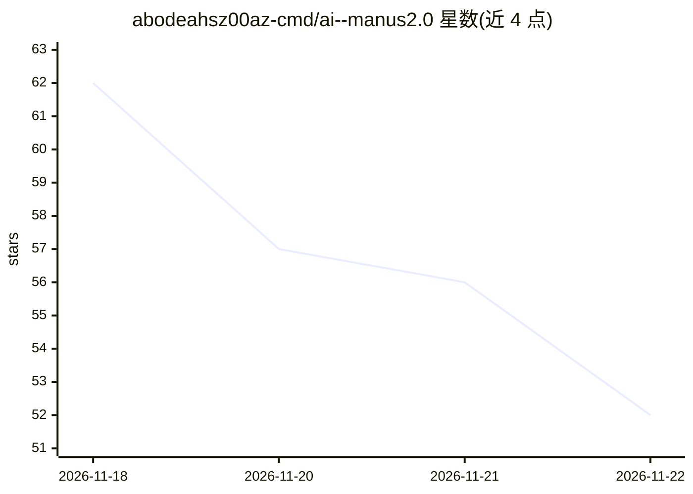

# abodeahsz00az-cmd/ai--manus2.0

⭐ 52 · Apache-2.0 · 推送 2026-11-18 · [GitHub](https://github.com/abodeahsz00az-cmd/ai--manus2.0) · 个人维护

**面向个人用户的自主 AI Agent，自动执行代码与浏览器任务**

README 将其描述为一个自主运行的 AI Agent：可自行编写并执行脚本、控制浏览器导航网页、填写表单、收集信息，并以后台个人助手形式处理重复性任务。定位为面向家庭、学习与轻量办公场景的小型助手，强调无需编程背景即可使用。全文为营销式介绍，未提供下载链接、安装命令、配置文件或源码入口，仅有 5 步通用使用流程与一张最低系统配置表。

## 筛选速览

| 维度 | 判定 | 备注 |
|---|---|---|
| AI 角色 | `ai-native` | 本体是模型或模型工具 |
| 许可风险 | `permissive` | Apache-2.0 |
| 部署形态 | `None` |  |
| 模型依赖 | — | README 未给出锁定关系 |
| 硬件要求 | — | 无带数字的原话,不猜 |
| 安装摩擦 | `low` | 无编译、无系统依赖或容器化 |
| 成熟度 | — | 结构信号不足 |

## 能力要点

- 自主执行代码与多步骤任务
- 浏览器控制：导航、填表、信息收集
- 后台个人助手模式，跨会话保持一致
- 给出最低系统配置表（64 位系统/双核 CPU/4GB 内存）

## 适用场景

- 收集资料并整理研究笔记
- 自动填写重复性网页表单
- 运行小脚本做快速实验与对比

## 场景标签

`AI 助手` `浏览器自动化` · 领域:效率与自动化

## 证据(README 行号)

> L10: - **Autonomous Code Execution:** Manus AI agent runs code on its own to complete tasks, so you can focus on decisio
> L18: Manus is an autonomous AI agent designed to run code and control a browser on your behalf. Instead of acting like a
> L22: Manus is not a heavy studio suite or a complex enterprise platform. It is a focused helper built for home, study, a

## 星数曲线

2026-11-18 62 → 2026-11-22 52（-10）

---
*卡片 v1 · prompt 1.4 · 生成 2026-11-19 · 置信度 low · 依据 README sha `f34361514505` · [字段定义](../../DATASET.md)*
