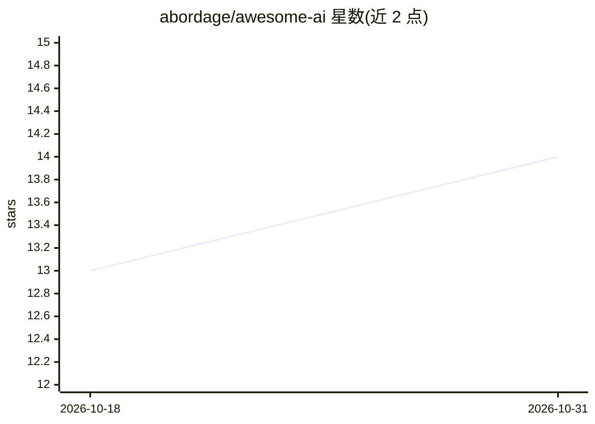

# abordage/awesome-ai

⭐ 14 · MIT · 推送 2026-10-30 · [GitHub](https://github.com/abordage/awesome-ai) · 组织维护

**自动化维护的 AI/ML 项目 awesome 清单，按活跃度每日重排**

聚合 GitHub 上 AI 与机器学习项目的自动维护清单：通过每日 GitHub API 更新扫描仓库、过滤长期不活跃项目、按当前活跃度指标重新计算得分并重建列表，同时合并社区 PR。条目按 AI 编码代理（通用/Claude Code/Gemini CLI/PR 审查）、生成器、IDE 扩展、SDK 与库等类别组织，每条附星标数。另指引至姊妹清单 Awesome MCP（MCP 服务器/客户端/框架清单）。面向查找 AI 开发工具的开发者。

## 筛选速览

| 维度 | 判定 | 备注 |
|---|---|---|
| AI 角色 | `ai-knowledge` | 知识聚合/清单类 |
| 许可风险 | `permissive` | MIT |
| 部署形态 | `None` |  |
| 模型依赖 | — | README 未给出锁定关系 |
| 硬件要求 | — | 无带数字的原话,不猜 |
| 安装摩擦 | `low` | 无编译、无系统依赖或容器化 |
| 成熟度 | — | 结构信号不足 |

## 能力要点

- 每日 GitHub API 自动扫描与基于活跃度指标的重新排名
- 按 AI Coding Agents、Generators、IDE & Editor、SDKs & Libraries 等类别组织
- 流程含合并社区 PR、过滤 stale 项目、重建列表
- 引用三个上游 awesome 清单作为来源

## 适用场景

- 按类别浏览当前活跃的 AI 开发工具项目
- 发现 Claude Code、Gemini CLI 周边的周边工具与扩展
- 跟踪按活跃度排序的 LLM/神经网络生态项目

## 场景标签

`精选清单` · 领域:学习与行业

## 证据(README 行号)

> L9: **Automated. Curated. Ranked.**
> L11: AI and machine learning projects hosted on GitHub. This awesome list is automatically maintained with daily GitHub 

## 星数曲线

2026-10-18 13 → 2026-10-31 14（+1）

---
*卡片 v1 · prompt 1.4 · 生成 2026-10-31 · 置信度 high · 依据 README sha `e01b19f6d264` · [字段定义](../../DATASET.md)*
