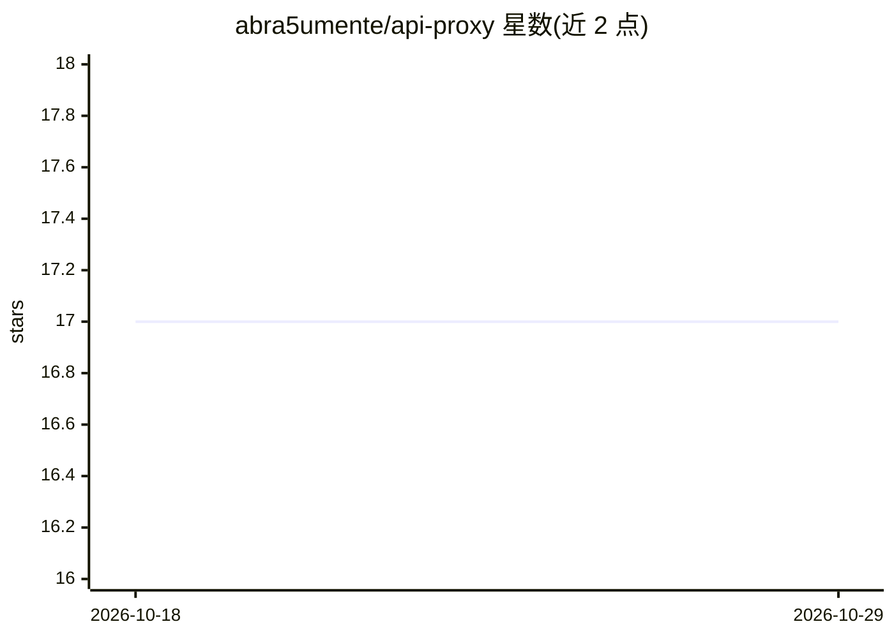

# abra5umente/api-proxy

⭐ 17 · Python · MIT · 推送 2026-09-26 · [GitHub](https://github.com/abra5umente/api-proxy) · 个人维护

**让 Claude Skills 经家庭住宅 IP 代理访问封锁数据中心 IP 的 API**

一个 Python 容器化代理服务：部署在家庭网络中，经 Cloudflare Tunnel 暴露，Claude 云容器的 Skills 请求通过它转发到目标 API，绕过 Reddit 等服务对云/数据中心 IP 段的封锁。提供 POST /proxy 端点（需 X-Proxy-Token 认证）与 GET /health 健康检查，支持域名白名单与请求超时配置；内置可复用的 Claude Skill 定义与 Python 辅助模块。安全上实现 SSRF 防护（目标仅限公网 IP、防 DNS 重绑定），容器不绑定主机端口。面向使用 Claude Skills 的开发者。

## 筛选速览

| 维度 | 判定 | 备注 |
|---|---|---|
| AI 角色 | `ai-ecosystem` | LLM/agent 周边工具 |
| 许可风险 | `permissive` | MIT |
| 部署形态 | `self-host` | docker 或自建部署 |
| 模型依赖 | — | README 未给出锁定关系 |
| 硬件要求 | — | 无带数字的原话,不猜 |
| 安装摩擦 | `low` | 无编译、无系统依赖或容器化 |
| 成熟度 | — | 结构信号不足 |

## 能力要点

- 通过住宅 IP 转发请求，绕过对云/数据中心 IP 的封锁
- POST /proxy 端点带 token 认证与域名白名单
- SSRF 防护：目标须解析为公网 IP 并固定 IP，防 DNS 重绑定
- 附赠 Claude Skill 定义与 proxy_helper.py 可复用模块

## 适用场景

- Claude Skill 访问 Reddit 等封锁云 IP 的 API 时改经家庭网络
- 为自建 skill 添加代理取数脚本，直连 403 时自动走代理
- 在自己服务器上控制可代理的 API 域名范围

## 场景标签

 · 领域:网络代理/AI 工具基础设施

## 证据(README 行号)

> L7: Claude's container runs from cloud infrastructure. Some APIs (notably Reddit) block requests from known cloud IP ran

## 星数曲线

2026-10-18 17 → 2026-10-29 17（+0）

---
*卡片 v1 · prompt 1.4 · 生成 2026-10-29 · 置信度 high · 依据 README sha `5429536d76aa` · [字段定义](../../DATASET.md)*
