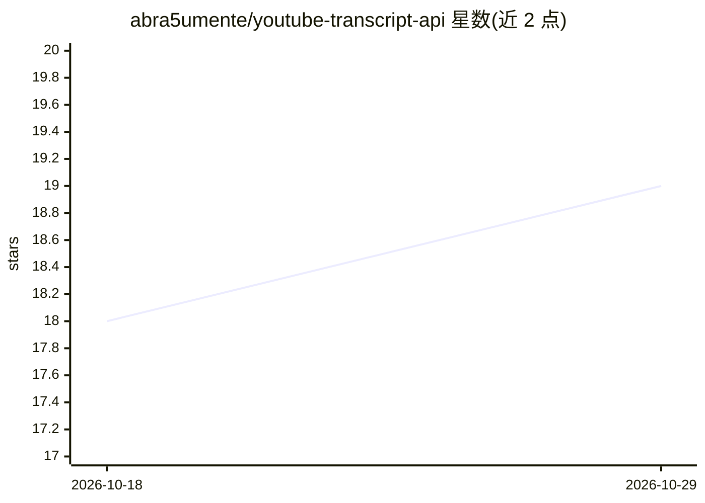

# abra5umente/youtube-transcript-api

⭐ 19 · Python · MIT · 推送 2025-12-29 · [GitHub](https://github.com/abra5umente/youtube-transcript-api) · 个人维护

**家庭宽带 IP 代理的 YouTube 字幕获取 API，供 Claude 调用**

在住宅 IP 上运行的 REST 服务，代理抓取 YouTube 视频字幕，绕过 YouTube 对云 IP 的封禁。提供带时间戳字幕、纯文本、可用字幕列表等端点，通过 X-Proxy-Token 鉴权，可选上游代理，并可用 Cloudflare Tunnel 暴露。附带 Claude skill：fetch-first, work-locally 模式先把字幕缓存到磁盘再本地 grep/cat，避免占满上下文，支持缓存索引与搜索。以 Docker 构建 + Python 脚本方式使用，限个人部署。

## 筛选速览

| 维度 | 判定 | 备注 |
|---|---|---|
| AI 角色 | `ai-ecosystem` | LLM/agent 周边工具 |
| 许可风险 | `permissive` | MIT |
| 部署形态 | `self-host` | docker 或自建部署 |
| 模型依赖 | locked-api |  |
| 硬件要求 | — | 无带数字的原话,不猜 |
| 安装摩擦 | `low` | 无编译、无系统依赖或容器化 |
| 成熟度 | — | 结构信号不足 |

## 能力要点

- 住宅 IP 代理绕过 YouTube 云 IP 封禁
- 4 个 REST 端点：健康检查/带时间戳字幕/纯文本/字幕列表
- Claude skill 先落盘缓存再用 grep/cat 本地处理，节省上下文
- Token 鉴权与可选上游代理配置

## 适用场景

- 让 Claude 总结、提问、做笔记某个 YouTube 视频
- 在云沙箱环境中通过自建代理获取 YouTube 字幕
- 批量缓存视频字幕供后续检索关键词与时间点

## 场景标签

`网页抓取` · 领域:效率与自动化

## 证据(README 行号)

> L7: YouTube blocks requests from cloud IPs (like Claude's sandbox), so fetching transcripts directly fails. This service
> L92: ## Claude Skill
> L98: The skill uses a **fetch-first, work-locally** approach to avoid blowing out Claude's context window:

## 星数曲线

2026-10-18 18 → 2026-10-29 19（+1）

---
*卡片 v1 · prompt 1.4 · 生成 2026-10-28 · 置信度 high · 依据 README sha `502b6f0115bc` · [字段定义](../../DATASET.md)*
