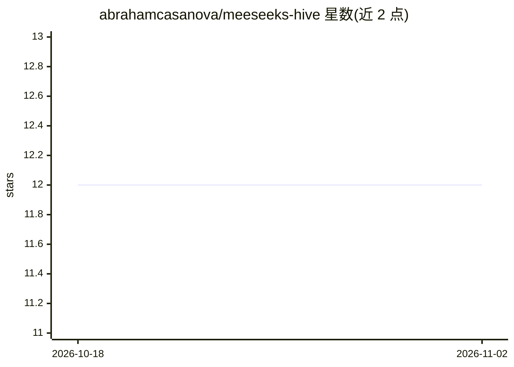

# abrahamcasanova/meeseeks-hive

⭐ 12 · TypeScript · MIT · 推送 2026-04-27 · [GitHub](https://github.com/abrahamcasanova/meeseeks-hive) · 个人维护

**自主 AI 代理蜂群：生成、沙箱执行并迭代改进代码策略**

TypeScript/React 项目：生成自主 AI 代理（Meeseeks），代理接收编程任务、生成 JavaScript 解、在隔离 Node.js 沙箱进程执行并评分，经 2–8 轮迭代改进代码，无需人工干预。代理通过 PostgreSQL+pgvector 共享策略数据库跨会话学习，高压时生成子代理并可竞速。生命周期经 Three.js 等距 3D 办公室视图与 Cytoscape.js 节点图实时可视化。支持 Anthropic/Bedrock/OpenAI/Ollama 作为 LLM 提供方，核心质量门以独立 npm 包 @meeseeks-sdk/core 提供，另有面向 Claude Code 的 MCP 服务器。

## 筛选速览

| 维度 | 判定 | 备注 |
|---|---|---|
| AI 角色 | `ai-native` | 本体是模型或模型工具 |
| 许可风险 | `permissive` | MIT |
| 部署形态 | `self-host` | docker 或自建部署 |
| 模型依赖 | local-ok | 支持本地模型 |
| 硬件要求 | — | 无带数字的原话,不猜 |
| 安装摩擦 | `low` | 无编译、无系统依赖或容器化 |
| 成熟度 | — | 结构信号不足 |

## 能力要点

- 代理在沙箱中生成-执行-评分-迭代的自主循环
- 策略持久化到 PostgreSQL(pgvector)，代理间跨会话共享学习链
- 子代理生成、多因子压力系统与双代理竞速模式
- Three.js 3D 办公室与 Cytoscape.js 图可视化 + 运行时可调参数

## 适用场景

- 观察自主代码代理的生成、竞争与演化过程
- 在自己的项目中用 @meeseeks-sdk/core 做代码质量门
- 让 Claude Code 在写入前经 MCP 服务器自动验证代码

## 场景标签

`编码 Agent` `多智能体` · 领域:Agent 开发

## 证据(README 行号)

> L19: Meeseeks Hive spawns autonomous AI agents ("Meeseeks") that receive coding tasks, generate JavaScript solutions, ex
> L61: |**Autonomous Loop**|Agents run 2–8 iterations, generating and executing code each cycle|
> L63: |**Strategy Evolution**|Agents persist winning strategies (score ≥ 8) to PostgreSQL for future agents|

## 星数曲线

2026-10-18 12 → 2026-11-02 12（+0）

---
*卡片 v1 · prompt 1.4 · 生成 2026-11-01 · 置信度 high · 依据 README sha `aed3f7edd240` · [字段定义](../../DATASET.md)*
