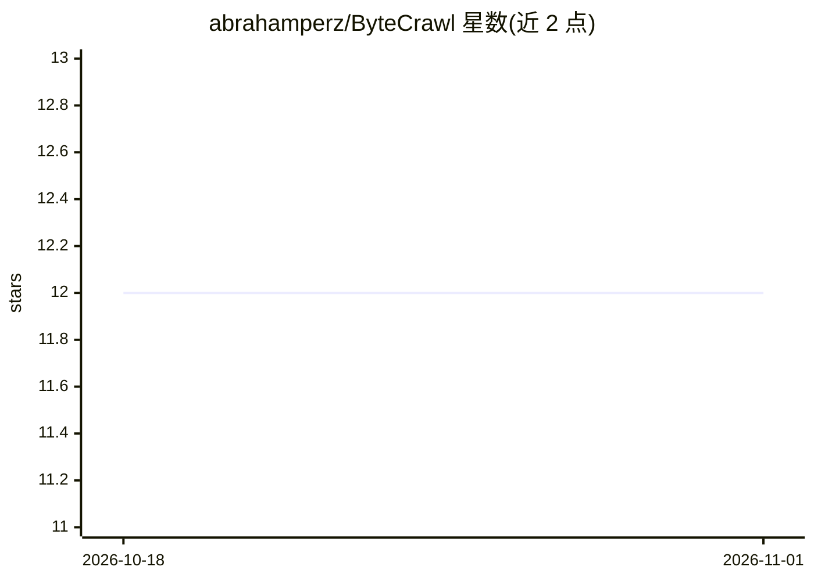

# abrahamperz/ByteCrawl

⭐ 12 · Python · MIT · 推送 2026-10-10 · [GitHub](https://github.com/abrahamperz/ByteCrawl) · [官网](https://bytecrawl.vercel.app) · 个人维护

**给 AI agent 用的聚焦爬虫 MCP 服务器与 Python 库**

以 MCP 服务器形式向 AI agent 提供六个爬取工具：按查询主题对整站排序的聚焦爬取（Shark-Search/OPIC/BFS 三种策略）、单页转 Markdown（声称约 6.5 倍 token 减少）、CSS 选择器结构化抽取、链接列举与 JSON API 访问。也可作为 Python 库使用，支持 Playwright 浏览器渲染、分页与登录会话。提供托管端点（仅静态页、限速、每次爬取上限 10 页），本地运行经 pipx/pip 安装。

## 筛选速览

| 维度 | 判定 | 备注 |
|---|---|---|
| AI 角色 | `ai-ecosystem` | LLM/agent 周边工具 |
| 许可风险 | `permissive` | MIT |
| 部署形态 | `library` | 以包/库形式分发 |
| 模型依赖 | — | README 未给出锁定关系 |
| 硬件要求 | — | 无带数字的原话,不猜 |
| 安装摩擦 | `low` | 无编译、无系统依赖或容器化 |
| 成熟度 | — | 结构信号不足 |

## 能力要点

- Shark-Search/OPIC/BFS 三种聚焦爬取策略，按主题相关度排序整站页面
- 六个 MCP 工具：聚焦爬取、策略对比、单页 Markdown、结构化抽取、链接列举、JSON API 访问
- Python 库形式支持 Playwright 浏览器渲染、分页与登录会话
- 提供托管 HTTP 端点，无需安装、无需 key

## 适用场景

- 让 Claude 等 agent 按我的主题爬取并排序整个站点
- 把网页转成干净 Markdown 喂给 LLM，减少 token 消耗
- 用 CSS 选择器从页面批量抽取结构化数据

## 场景标签

`网页抓取` · 领域:效率与自动化

## 证据(README 行号)

> L11: **Give your AI agent focused web crawling.** ByteCrawl is an MCP server (and a
> L75: claude mcp add --scope user --transport http bytecrawl https://bytecrawl.vercel.app/mcp

## 星数曲线

2026-10-18 12 → 2026-11-01 12（+0）

---
*卡片 v1 · prompt 1.4 · 生成 2026-11-01 · 置信度 high · 依据 README sha `3b0bd18e2ad6` · [字段定义](../../DATASET.md)*
