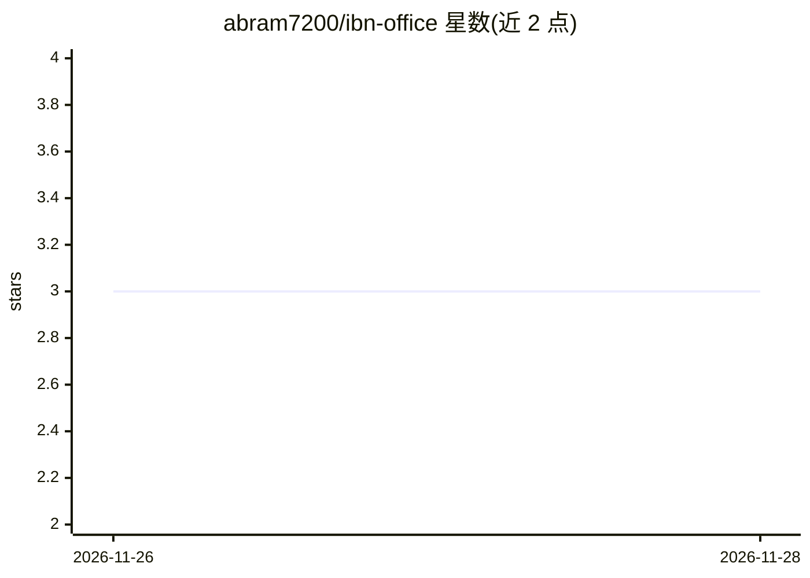

# abram7200/ibn-office

⭐ 3 · Python · MIT · 推送 2026-11-27 · [GitHub](https://github.com/abram7200/ibn-office) · [官网](https://abram7200.github.io/ibn-office/) · 个人维护

**把本机多个 AI 编码代理编排成团队协作的办公室层**

IBN Office 在 Windows 上运行，把用户已装的 AI 代理（Claude Code、Codex、OpenCode、Gemini、Qwen 等）组织成 Manager 规划、Deputy 复核、Secretary 记录、Workers 执行的角色分工，并提供 3D 办公室仪表盘展示实时进度。关键机制包括：App Atlas 记录本机程序与接口（MCP/COM/CLI）、配额耗尽时切换下一个模型（Free-First）、25%-85% 处的上下文检查点、5 小时用量守卫、Windows job object 防止残留进程。限制：面向 Windows，依赖用户已有代理；安装通过向 Claude Code/Codex 粘贴一条提示完成。

## 筛选速览

| 维度 | 判定 | 备注 |
|---|---|---|
| AI 角色 | `ai-ecosystem` | LLM/agent 周边工具 |
| 许可风险 | `permissive` | MIT |
| 部署形态 | `library` | 以包/库形式分发 |
| 模型依赖 | — | README 未给出锁定关系 |
| 硬件要求 | — | 无带数字的原话,不猜 |
| 安装摩擦 | `low` | 无编译、无系统依赖或容器化 |
| 成熟度 | — | 结构信号不足 |

## 能力要点

- Manager/Deputy/Secretary 角色分工与独立复核机制
- App Atlas 发现本机程序并通过 MCP/COM/CLI 驱动
- 配额 failover 与 Free-First 模型切换
- 上下文检查点、5 小时守卫与 Windows job object 进程管理

## 适用场景

- 让多个编码代理按计划分工完成一项任务并由独立代理复核
- 配额耗尽时自动切换模型避免工作中断
- 通过 3D 仪表盘查看各代理的任务进度与耗时

## 场景标签

`多智能体` `编码 Agent` · 领域:Agent 开发

## 证据(README 行号)

> L4: A Manager plans, a Deputy checks, a Secretary records, and every AI agent on your computer gets a desk —
> L34: operating layer on top of Windows: it finds every program, tool, plug-in and agent on the PC, learns how each works
> L60: **IBN Office turns them into a team.** It does not replace your agents: it organises them. You keep typing to your

## 星数曲线

2026-11-26 3 → 2026-11-28 3（+0）

---
*卡片 v1 · prompt 1.4 · 生成 2026-11-26 · 置信度 mid · 依据 README sha `c9d71175b034` · [字段定义](../../DATASET.md)*
