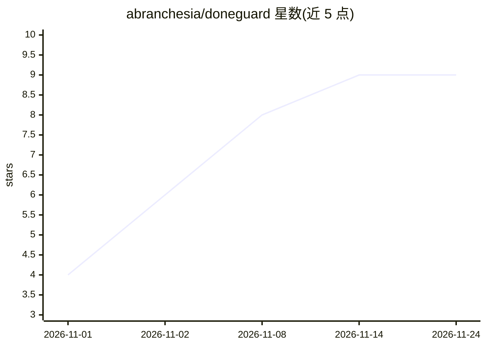

# abranchesia/doneguard

⭐ 9 · Python · MIT · 推送 2026-11-08 · [GitHub](https://github.com/abranchesia/doneguard) · [官网](https://pypi.org/project/doneguard/) · 个人维护

**给 AI 编码代理装停止门：检查不过不许说完成**

doneguard 是一个 stop hook 工具：当 Claude Code、Codex、Cursor 等编码代理尝试结束会话时，它运行类型检查、linter 和与本次改动相关的测试，失败则将错误回传给代理继续修复。支持在 Docker 中启动一次性 Postgres/MySQL/Redis/MongoDB 跑集成测试、以真实浏览器运行 Playwright/Cypress 并保留截图视频作为证据、拦截 test.skip 与 @ts-ignore 等偷懒行为，连续 3 次失败后放行作为安全阀。通过 PyPI 以 uv/pipx 安装，零依赖，要求 Python 3.9+ 与 macOS/Linux。

## 筛选速览

| 维度 | 判定 | 备注 |
|---|---|---|
| AI 角色 | `ai-ecosystem` | LLM/agent 周边工具 |
| 许可风险 | `permissive` | MIT |
| 部署形态 | `library` | 以包/库形式分发 |
| 模型依赖 | locked-api |  |
| 硬件要求 | — | 无带数字的原话,不猜 |
| 安装摩擦 | `medium` | 含编译或系统依赖之一 |
| 成熟度 | — | 结构信号不足 |

## 能力要点

- stop hook 机制：代理声明完成前自动运行类型检查、linter 与相关测试，失败回传继续工作
- Docker 启动一次性数据库（Postgres/MySQL/Redis/MongoDB）跑集成测试并自动清理
- E2E 测试保留截图与视频到 .doneguard/evidence/，失败时回传错误与页面快照
- 拦截 test.skip、@ts-ignore、as any、硬编码 API key 等绕过行为

## 适用场景

- 防止 AI 编码代理在类型错误、测试未过时声称完成
- 集成测试需要数据库时代理不污染真实数据库
- 团队与 CI 共享同一份 .doneguard 检查配置

## 场景标签

`编码 Agent` `代码审查` `浏览器自动化` · 领域:效率与自动化

## 证据(README 行号)

> L17: doneguard is a **stop hook**. When the agent tries to finish, doneguard runs your type checker, linter and *related
> L35: Not using Claude Code? doneguard speaks each agent's own hook format. `doneguard init` hooks into the agents it fin

## 星数曲线

2026-11-01 4 → 2026-11-24 9（+5）

---
*卡片 v1 · prompt 1.4 · 生成 2026-11-20 · 置信度 mid · 依据 README sha `f233ea7bc00d` · [字段定义](../../DATASET.md)*
