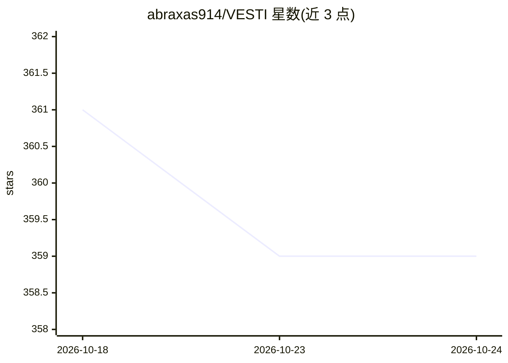

# abraxas914/VESTI

⭐ 359 · TypeScript · 推送 2026-10-18 · [GitHub](https://github.com/abraxas914/VESTI) · 个人维护 · 中文 README

**本地优先的 AI 对话记忆中台：跨平台捕获、检索与问答**

双层架构的 Chrome 扩展：捕获引擎层监听 ChatGPT、Claude、Gemini、DeepSeek、Qwen、Doubao 六个平台的页面对话，自动提取并存储到本地 IndexedDB；知识管理层（Web Dashboard）提供对话库管理（Library）、本地 RAG 自然语言问答（Explore）、向量相似度图谱（Network）与 Markdown 策展笔记（Notes）。摘要与向量化通过 ModelScope API（DeepSeek-R1-Distill-Qwen-14B 主模型、Qwen3-14B 备用）驱动，支持 Demo 与 BYOK 模式，跨设备同步与云端备份为当前未实现项。

## 筛选速览

| 维度 | 判定 | 备注 |
|---|---|---|
| AI 角色 | `ai-native` | 本体是模型或模型工具 |
| 许可风险 | `none` | — |
| 部署形态 | `None` |  |
| 模型依赖 | — | README 未给出锁定关系 |
| 硬件要求 | — | 无带数字的原话,不猜 |
| 安装摩擦 | `low` | 无编译、无系统依赖或容器化 |
| 成熟度 | `idea` | |

## 能力要点

- 六平台对话自动捕获，数据存本地 IndexedDB 不上云
- 本地向量库 RAG 问答（Explore），回答附来源对话引用溯源
- Gardener Agent 后台对对话做分类、标签与主题归档，决策链可追溯
- ECharts 力导向图可视化对话间语义关联（Network）

## 适用场景

- 把散落在多个 AI 平台的对话集中收纳并全文检索
- 用自然语言向自己的历史对话提问并获得带引用的回答
- 将高价值对话沉淀为笔记并可视化跨平台思维关联

## 场景标签

`知识库管理` `RAG` `文档问答` · 领域:知识与检索

## 证据(README 行号)

> L80: 心迹当前版本由两个协同工作的层次构成。**捕获引擎层**是 Chrome 浏览器扩展本体，负责跨平台（ChatGPT、Claude、Gemini、DeepSeek、Qwen、Doubao）的对话监听、结构化摘要生成和本地持久化。*
> L93: * **实时捕获**：当你在 ChatGPT、Claude、Gemini、DeepSeek、Qwen 或 Doubao 页面进行对话时，心迹在后台静默工作，自动提取对话内容并存储到本地 IndexedDB。这个过程完全自动化且不可
> L122:  2. 生成式洞察引擎 (RAG) 基于召回的专属记忆，Agent 动态合成带有引用的结构化解答，让长时段的隐性知识显性化。
> L196: * **AI 模型**：主模型为 `DeepSeek-R1-Distill-Qwen-14B`（具备深度推理能力），备用模型为 `Qwen/Qwen3-14B`。支持 Demo 模式（通过开发者代理路由，开箱可用）与 BYOK 

## 星数曲线

2026-10-18 361 → 2026-10-24 359（-2）

---
*卡片 v1 · prompt 1.4 · 生成 2026-10-21 · 置信度 high · 依据 README sha `c5afb43cec0c` · [字段定义](../../DATASET.md)*
