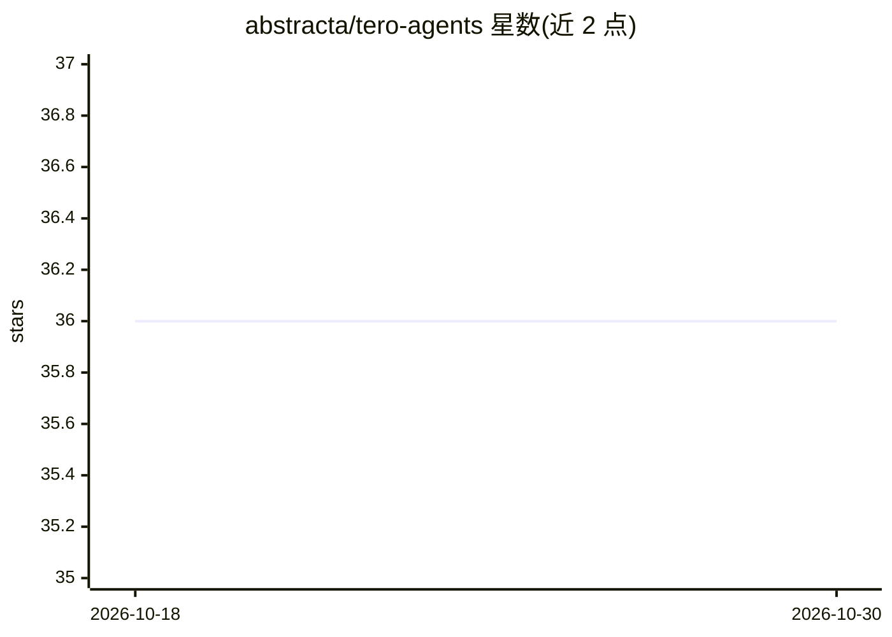

# abstracta/tero-agents

⭐ 36 · Apache-2.0 · 推送 2026-09-23 · [GitHub](https://github.com/abstracta/tero-agents) · 组织维护

**Tero 平台的社区 agent 集合：浏览、导入与贡献软件质量 agent**

Abstracta 维护的 Tero agents 开源社区仓库：收录社区贡献的 agent，条目索引在 index.md，按语言目录（en/es 等，ISO 639-1）组织。使用方式为克隆或下载仓库（克隆需 git-lfs），将所选 agent 文件夹打包为 ZIP 后在 Tero 实例中导入并配置（如 Jira 或 MCP 凭证）；贡献流程为从 Tero 导出、去除私有提示词后提交 PR。维护者仅做基础检查，不保证功能与质量测试，需使用者自行审查。

## 筛选速览

| 维度 | 判定 | 备注 |
|---|---|---|
| AI 角色 | `ai-knowledge` | 知识聚合/清单类 |
| 许可风险 | `permissive` | Apache-2.0 |
| 部署形态 | `None` |  |
| 模型依赖 | — | README 未给出锁定关系 |
| 硬件要求 | — | 无带数字的原话,不猜 |
| 安装摩擦 | `low` | 无编译、无系统依赖或容器化 |
| 成熟度 | — | 结构信号不足 |

## 能力要点

- 社区贡献 agent 的策展仓库，索引见 index.md
- 通过 clone 或 ZIP 下载后打包导入 Tero 实例使用
- 按语言目录（ISO 639-1）组织条目
- 维护者仅做基础检查，不完整测试 agent 功能与质量

## 适用场景

- 为我的 Tero 实例挑选社区贡献的软件质量 agent
- 把自己在 Tero 中搭建的 agent 导出并回馈社区
- 按作者（如 Abstracta）作为质量信号筛选 agent

## 场景标签

`精选清单` · 领域:学习与行业

## 证据(README 行号)

> L3: This is the open community repository for Tero agents.
> L5: Here you can find a curated set of agents contributed by the community that you can use in your Tero instance, and y

## 星数曲线

2026-10-18 36 → 2026-10-30 36（+0）

---
*卡片 v1 · prompt 1.4 · 生成 2026-10-25 · 置信度 high · 依据 README sha `cc5437c13a04` · [字段定义](../../DATASET.md)*
