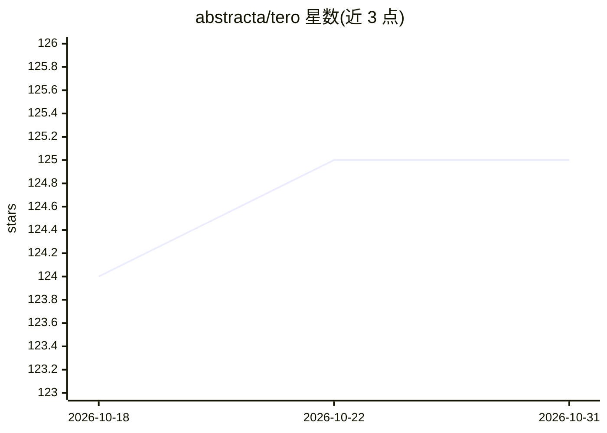

# abstracta/tero

⭐ 125 · Python · Apache-2.0 · 推送 2026-10-14 · [GitHub](https://github.com/abstracta/tero) · [官网](https://abstracta.github.io/tero/) · 组织维护

**创建、共享与运行 AI agent 的平台，面向软件质量流程**

用于创建、共享和使用 AI agent 的平台，聚焦软件质量过程。支持用自有 AI 模型快速构建 agent，内置 Jira、MCP、浏览器、Web、Docs 等工具；可在团队内共享 agent，浏览社区贡献的 agent 目录；支持为 agent 定义并运行测试套件，通过 AI Console 查看使用报告；提供按用户的预算控制。可与 GitHub Copilot、Cursor 集成，并有浏览器扩展 Tero Copilot。本地运行需 OpenAI 或 Azure OpenAI 的 key，通过 Docker Compose 启动，Docker 为必需依赖。

## 筛选速览

| 维度 | 判定 | 备注 |
|---|---|---|
| AI 角色 | `ai-ecosystem` | LLM/agent 周边工具 |
| 许可风险 | `permissive` | Apache-2.0 |
| 部署形态 | `self-host` | docker 或自建部署 |
| 模型依赖 | — | README 未给出锁定关系 |
| 硬件要求 | — | 无带数字的原话,不猜 |
| 安装摩擦 | `low` | 无编译、无系统依赖或容器化 |
| 成熟度 | — | 结构信号不足 |

## 能力要点

- 内置 Jira、MCP、Browser、Web、Docs 等 agent 工具
- 团队内共享 agent 与社区贡献目录
- 为 agent 定义并运行测试套件，AI Console 查看报告
- 按用户预算控制成本

## 适用场景

- 软件质量团队构建并复用 AI agent
- 通过测试套件验证 agent 行为
- 在 Web 页面通过浏览器扩展使用 agent

## 场景标签

`Agent 框架` · 领域:Agent 开发

## 证据(README 行号)

> L1: Tero is a platform to create, share and use AI agents with focus on empowering software quality processes.
> L10: - **Build powerful agents** using built-in tools (e.g., Jira, MCP, Browser, Web, Docs).

## 星数曲线

2026-10-18 124 → 2026-10-31 125（+1）

---
*卡片 v1 · prompt 1.4 · 生成 2026-10-23 · 置信度 high · 依据 README sha `923c09c6f4bd` · [字段定义](../../DATASET.md)*
