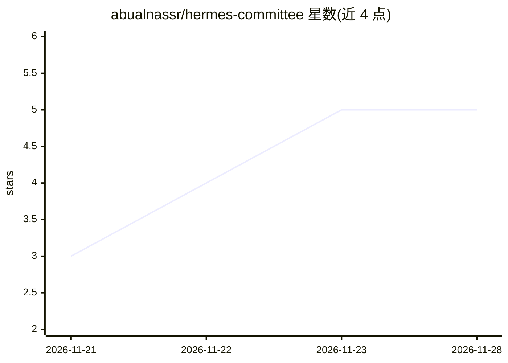

# abualnassr/hermes-committee

⭐ 5 · Python · MIT · 推送 2026-11-23 · [GitHub](https://github.com/abualnassr/hermes-committee) · 个人维护

**给 Hermes Agent 用的多模型委员会决策插件：盲评辩论出裁决**

作为 Hermes Agent 的插件运行：用户提出问题并附证据文件、照片，各席位以不同角色和模型独立作答，互相盲投排名，分歧时辩论，最后由主席模型写出裁决、异议与后续行动。支持可选的网络研究前置步骤、时间与预算上限、Desktop 实时页面，输出 Markdown 与 PDF 报告。需 Hermes 0.23.0 及以上，通过 hermes plugins 命令安装。

## 筛选速览

| 维度 | 判定 | 备注 |
|---|---|---|
| AI 角色 | `ai-native` | 本体是模型或模型工具 |
| 许可风险 | `permissive` | MIT |
| 部署形态 | `None` |  |
| 模型依赖 | — | README 未给出锁定关系 |
| 硬件要求 | — | 无带数字的原话,不猜 |
| 安装摩擦 | `low` | 无编译、无系统依赖或容器化 |
| 成熟度 | — | 结构信号不足 |

## 能力要点

- 席位独立作答、盲投排名、分歧辩论、主席裁决的四段流程
- 证据支持文件、文件夹、粘贴文本与照片（JPG/PNG/WebP/HEIC）
- 可选 Research first：网络搜索最多读 8 页并按来源引用
- 2–8 个可编辑席位，含 6 种预设委员会类型与思考等级设置

## 适用场景

- 在几个方案之间做技术或工程决策时收集多模型意见
- 对计划或设计文档做红队式压力测试
- 结合设备检查报告与照片做维护决策

## 场景标签

`多智能体` · 领域:Agent 开发

## 证据(README 行号)

> L5: **Ask several AI models the same hard question. They answer on their own, rank each other's
> L8: A plugin for Hermes Agent. Give each seat a role, a model
> L29: hermes plugins install abualnassr/hermes-committee

## 星数曲线

2026-11-21 3 → 2026-11-28 5（+2）

---
*卡片 v1 · prompt 1.4 · 生成 2026-11-22 · 置信度 mid · 依据 README sha `79e9fe3ff98e` · [字段定义](../../DATASET.md)*
