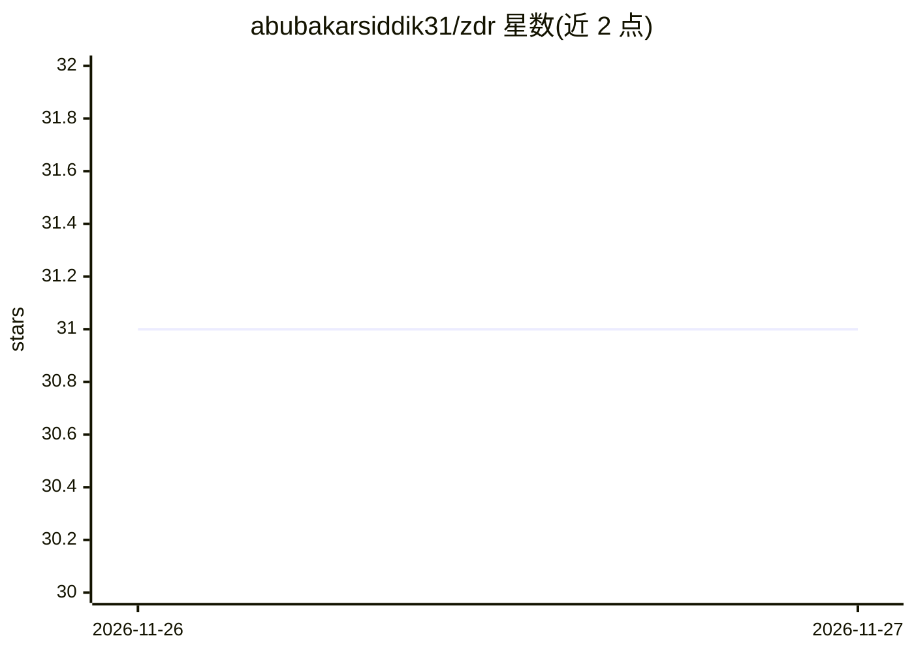

# abubakarsiddik31/zdr

⭐ 31 · Apache-2.0 · 推送 2026-11-25 · [GitHub](https://github.com/abubakarsiddik31/zdr) · [官网](https://abubakar-siddik.com/guides/zero-data-retention-llm-providers) · 个人维护

**LLM API 零数据保留（ZDR）知识参考：查各供应商政策**

面向需要在 LLM 调用中控制数据保留的开发者与合规人员的参考站点/仓库：整理 16 家 LLM 供应商的零数据保留（ZDR）政策，每页给出默认保留行为、开启方式（默认/自助/申请/不提供）、例外情况与编号来源链接，每条声明链接到供应商官方文档。另含选择路径的决策流程图、威胁模型、合规（HIPAA/GDPR 等）、自托管与验证等主题指南，以及 2026 年政策变化记录。Apache 2.0 许可，欢迎 PR。

## 筛选速览

| 维度 | 判定 | 备注 |
|---|---|---|
| AI 角色 | `ai-knowledge` | 知识聚合/清单类 |
| 许可风险 | `permissive` | Apache-2.0 |
| 部署形态 | `None` |  |
| 模型依赖 | — | README 未给出锁定关系 |
| 硬件要求 | — | 无带数字的原话,不猜 |
| 安装摩擦 | `low` | 无编译、无系统依赖或容器化 |
| 成熟度 | — | 结构信号不足 |

## 能力要点

- 覆盖 16 家供应商的 ZDR 政策，每条声明链接供应商官方文档
- 四档 ZDR 可用性分级：默认/自助/申请/不提供
- 含选择路径决策流程图与威胁模型、合规、验证等主题指南
- 记录 2026 年各供应商政策变化

## 适用场景

- 选型时查询某家 LLM API 是否支持零数据保留及如何开启
- 为 HIPAA/GDPR 合规评估供应商数据处理条款
- 决定采用云 API、网关还是自托管方案
- 跟踪各供应商数据保留政策的最新变化

## 场景标签

 · 领域:LLM 基础设施/合规与隐私知识

## 证据(README 行号)

> L5: **Which LLM providers offer zero data retention, how to turn it on, and what it still doesn't cover.**
> L19: ## Provider guides

## 星数曲线

2026-11-26 31 → 2026-11-27 31（+0）

---
*卡片 v1 · prompt 1.4 · 生成 2026-11-26 · 置信度 high · 依据 README sha `d4bfdd9c2502` · [字段定义](../../DATASET.md)*
