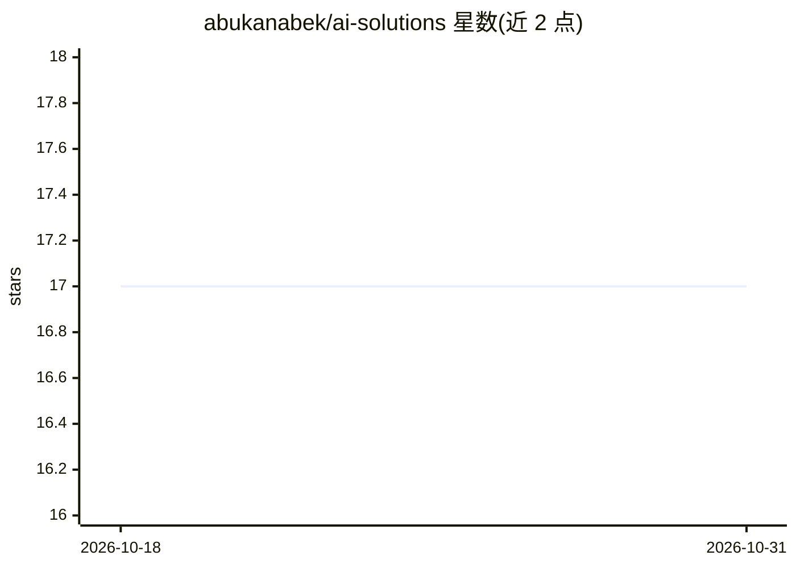

# abukanabek/ai-solutions

⭐ 17 · Jupyter Notebook · MIT · 推送 2026-07-03 · [GitHub](https://github.com/abukanabek/ai-solutions) · 个人维护

**个人 AI/ML 竞赛与信息学奥赛解题代码集合**

个人维护的解题仓库，收录作者在多项 AI/ML 竞赛（如 Benin、Colombian、Japanese、Kazakhstan、Russian、Slovak 等 AI Olympiad，以及 AICC、mlcompete、neoai、nitro-ai）中完成的 NLP、CV、经典 ML 等任务代码，另设 general-notebooks 目录存放通用笔记本。README 仅列目录索引与许可指向，未提供安装命令、运行说明或依赖说明。

## 筛选速览

| 维度 | 判定 | 备注 |
|---|---|---|
| AI 角色 | `ai-knowledge` | 知识聚合/清单类 |
| 许可风险 | `permissive` | MIT |
| 部署形态 | `None` |  |
| 模型依赖 | — | README 未给出锁定关系 |
| 硬件要求 | — | 无带数字的原话,不猜 |
| 安装摩擦 | `low` | 无编译、无系统依赖或容器化 |
| 成熟度 | — | 结构信号不足 |

## 能力要点

- 覆盖 12 个竞赛目录的解题代码
- 涉及 NLP、CV、经典 ML 等任务类型
- 另含 general-notebooks 通用笔记本目录

## 适用场景

- 参考各 AI 奥赛/竞赛的解题实现
- 查阅不同 ML 任务的个人代码写法

## 场景标签

 · 领域:机器学习/竞赛代码

## 证据(README 行号)

> L3:  Repository containing my solutions for AI/ML competitions and tasks (NLP, CV, Classic ML, and more).
> L60: ## Competitions

## 星数曲线

2026-10-18 17 → 2026-10-31 17（+0）

---
*卡片 v1 · prompt 1.4 · 生成 2026-10-29 · 置信度 mid · 依据 README sha `23615df0e42e` · [字段定义](../../DATASET.md)*
