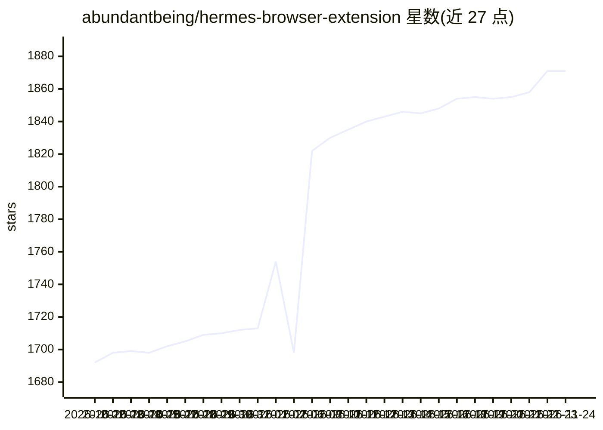

# abundantbeing/hermes-browser-extension

⭐ 1,879 · JavaScript · MIT · 推送 2026-11-23 · [GitHub](https://github.com/abundantbeing/hermes-browser-extension) · 个人维护

**连接本地 Hermes Agent 的浏览器侧边栏扩展客户端**

为 Nous Research 的 Hermes Agent 提供的 Chromium/Firefox 浏览器扩展，以侧边栏形式接入本地网关、Hermes Cloud 或自托管远程网关。核心机制：读取当前网页上下文并发送给已配置的 Hermes 运行时，复用其模型、工具、技能、会话与 MCP 服务器；Hermes Control（可选择性授权 Hermes 操作标签页）在 Chromium 上完整、Firefox 上受限（无点击/键入）。含 Bot Mode 多 agent 群聊、文件附件、标签页截图、主题外观等。依赖已安装并配置 API_SERVER_KEY 的 Hermes Agent。

## 筛选速览

| 维度 | 判定 | 备注 |
|---|---|---|
| AI 角色 | `ai-ecosystem` | LLM/agent 周边工具 |
| 许可风险 | `permissive` | MIT |
| 部署形态 | `library` | 以包/库形式分发 |
| 模型依赖 | — | README 未给出锁定关系 |
| 硬件要求 | — | 无带数字的原话,不猜 |
| 安装摩擦 | `low` | 无编译、无系统依赖或容器化 |
| 成熟度 | — | 结构信号不足 |

## 能力要点

- 支持本地网关、Hermes Cloud、自托管远程三种连接方式
- Hermes Control 授权 agent 读取/操作标签页，Chromium 完整、Firefox 受限
- Bot Mode 支持多 agent 群聊与 agent 配置编辑
- 每次操作需用户审批，敏感页面与字段保持阻断

## 适用场景

- 在浏览器侧边栏直接与本地 Hermes agent 对话并传入当前页面上下文
- 让 Hermes 在授权的标签页内点击、输入、导航完成任务
- 多个 Hermes agent 在同一房间进行群聊讨论

## 场景标签

`多智能体` `浏览器自动化` `聊天机器人` · 领域:Agent 开发

## 证据(README 行号)

> L3: Browser-native side panel for Hermes Agent — connect active web context through a local gateway, Hermes Cloud, or a 
> L31: Hermes Browser Extension is not a browser chatbot. It is a Chromium side panel or Firefox sidebar for the real Herm
> L66: - Hermes Agent installed and working, with its API server key set (`API_SERVER_KEY`, 16 or more characters). Hermes

## 星数曲线

2026-10-22 1,692 → 2026-11-24 1,871（+179）

---
*卡片 v1 · prompt 1.4 · 生成 2026-11-24 · 置信度 high · 依据 README sha `b0e769367193` · [字段定义](../../DATASET.md)*
