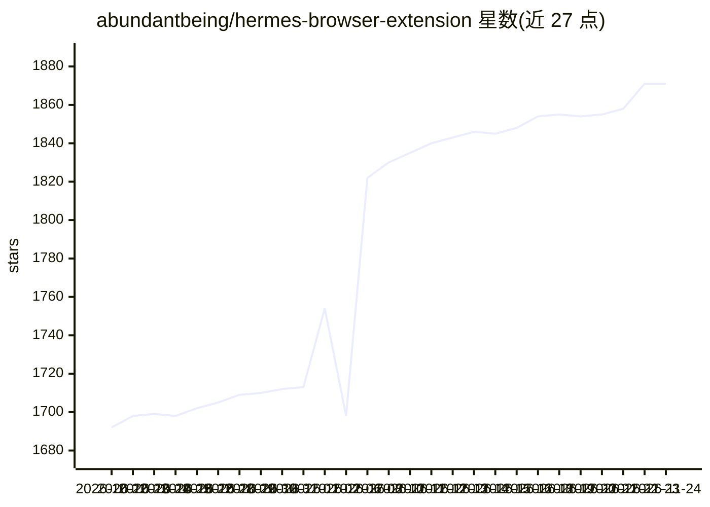

# abundantbeing/hermes-browser-extension

⭐ 1,871 · JavaScript · MIT · 推送 2026-11-22 · [GitHub](https://github.com/abundantbeing/hermes-browser-extension) · 个人维护

**为 Hermes Agent 提供浏览器侧栏客户端：接入本地/云/远程网关**

面向 Hermes Agent（Nous Research）用户的社区浏览器扩展，在 Chromium 侧栏或 Firefox 侧边栏中提供聊天与页面上下文接入。支持三种连接：本地网关、Hermes Cloud、自托管远程 API/dashboard；可复用 Hermes 已配置的模型、工具、会话、记忆与 MCP 服务器。Hermes Control 功能支持代理操作标签页（点击、输入、滚动），Chromium 上完整，Firefox 上受限（无 debugger API，仅可读取/打开/切换标签页）。页面上下文共享默认关闭，需逐连接显式批准。需 Node.js 20+ 从源码构建 Chromium 版本，Firefox 版经 Mozilla Add-ons 分发。

## 筛选速览

| 维度 | 判定 | 备注 |
|---|---|---|
| AI 角色 | `ai-ecosystem` | LLM/agent 周边工具 |
| 许可风险 | `permissive` | MIT |
| 部署形态 | `library` | 以包/库形式分发 |
| 模型依赖 | — | README 未给出锁定关系 |
| 硬件要求 | — | 无带数字的原话,不猜 |
| 安装摩擦 | `low` | 无编译、无系统依赖或容器化 |
| 成熟度 | — | 结构信号不足 |

## 能力要点

- 三通道连接：本地网关、Hermes Cloud、自托管远程 API/dashboard
- Hermes Control 代理操作标签页（点击/输入/导航），风险动作需审批
- Bot Mode 多 Agent 群聊、实时会话跟进（Steer/Queue/Stop）
- 页面上下文共享需逐连接显式批准，截图不自动采集

## 适用场景

- 在浏览器侧栏直接与本地运行的 Hermes Agent 对话
- 让 Hermes 代理操作当前标签页完成任务
- 多 Agent 群聊中向多个配置好的 agent 同时提问

## 场景标签

`聊天机器人` `浏览器自动化` `多智能体` · 领域:Agent 开发

## 证据(README 行号)

> L31: Hermes Browser Extension is not a browser chatbot. It is a Chromium side panel or Firefox sidebar for the real Herm
> L67: - Chrome, Edge, Brave, Comet, or another Chromium browser with Side Panel API support (Chrome 116+), or Firefox 142
> L68: - Node.js 20+ to build the Chromium extension from source. `npm run build:firefox` is for local/dev Firefox builds 

## 星数曲线

2026-10-22 1,692 → 2026-11-24 1,871（+179）

---
*卡片 v1 · prompt 1.4 · 生成 2026-11-23 · 置信度 high · 依据 README sha `e44e7163d634` · [字段定义](../../DATASET.md)*
