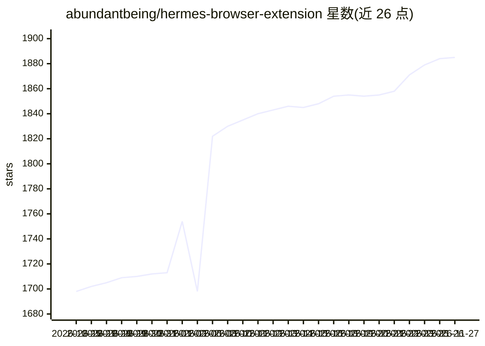

# abundantbeing/hermes-browser-extension

⭐ 1,885 · JavaScript · MIT · 推送 2026-11-24 · [GitHub](https://github.com/abundantbeing/hermes-browser-extension) · 个人维护

**给 Hermes Agent 的浏览器侧边栏客户端：接入网页上下文**

由 Jon Komet 维护的社区扩展（MIT 许可），为 Nous Research 的 Hermes Agent 提供 Chromium 侧边栏/Firefox 侧边栏客户端。通过本地网关、Hermes Cloud 或自托管远程网关连接 Hermes 运行时，读取活动网页上下文并发送附件。提供 Bot Mode 多代理群聊、Hermes Control 标签页控制（点击/输入/滚动，Chromium 完整、Firefox 受限）、文件附件、标签截图、语音朗读、主题外观等功能。要求已安装 Hermes Agent（API_SERVER_KEY），Chromium 116+ 或 Firefox 142+，源码构建需 Node.js 20+。

## 筛选速览

| 维度 | 判定 | 备注 |
|---|---|---|
| AI 角色 | `ai-ecosystem` | LLM/agent 周边工具 |
| 许可风险 | `permissive` | MIT |
| 部署形态 | `library` | 以包/库形式分发 |
| 模型依赖 | — | README 未给出锁定关系 |
| 硬件要求 | — | 无带数字的原话,不猜 |
| 安装摩擦 | `low` | 无编译、无系统依赖或容器化 |
| 成熟度 | — | 结构信号不足 |

## 能力要点

- 连接本地网关、Hermes Cloud 或自托管远程网关三种通道
- Hermes Control：代理可对附加标签页执行点击、输入、滚动、导航（Chromium 完整支持）
- Bot Mode 支持多代理群聊与代理配置编辑
- 审批门控：改变页面的操作需用户逐次批准

## 适用场景

- 在浏览器侧边栏直接与本地 Hermes Agent 对话并附带当前网页上下文
- 让 Hermes Agent 代为操作标签页（点击、填表、打开页面）
- 多个 Hermes 代理在同一房间群聊回答问题

## 场景标签

`浏览器自动化` `聊天机器人` `多智能体` · 领域:Agent 开发

## 证据(README 行号)

> L3: Browser-native side panel for Hermes Agent — connect active web context through a local gateway, Hermes Cloud, or a 
> L31: Hermes Browser Extension is not a browser chatbot. It is a Chromium side panel or Firefox sidebar for the real Herm

## 星数曲线

2026-10-25 1,698 → 2026-11-27 1,885（+187）

---
*卡片 v1 · prompt 1.4 · 生成 2026-11-26 · 置信度 high · 依据 README sha `e670fe677356` · [字段定义](../../DATASET.md)*
