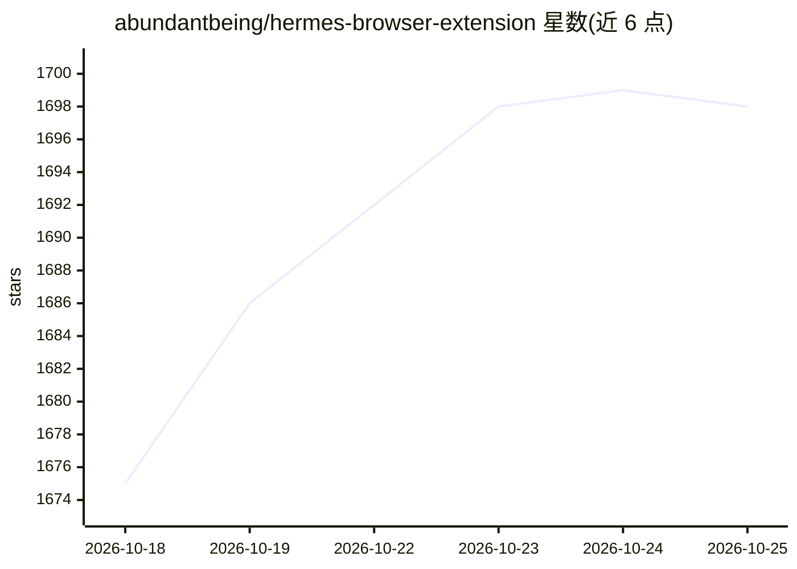

# abundantbeing/hermes-browser-extension

⭐ 1,698 · JavaScript · MIT · 推送 2026-10-20 · [GitHub](https://github.com/abundantbeing/hermes-browser-extension) · 个人维护

**连接本地 Hermes Agent 运行时的浏览器侧边栏扩展**

面向 Hermes Agent（Nous Research）用户的 Chromium 侧边栏/Firefox 侧栏扩展，把浏览器页面上下文接入本地网关、Hermes Cloud 或自托管远程网关。复用 Hermes 已配置的模型、工具、技能、会话、记忆与 MCP 服务器。提供 Bot Mode 群聊、文件附件、标签页截图、Hermes Control 标签操作（仅 Chromium）、实时会话与工具活动视图等。需先安装 Hermes Agent 与 Node.js 20+，通过 git clone 加 npm 构建生成 dist 后以开发者模式加载，Firefox 经 AMO 安装。群聊模式下页面上下文投递尚不可靠；Cloud 连接仅限 Chat-only。

## 筛选速览

| 维度 | 判定 | 备注 |
|---|---|---|
| AI 角色 | `ai-ecosystem` | LLM/agent 周边工具 |
| 许可风险 | `permissive` | MIT |
| 部署形态 | `library` | 以包/库形式分发 |
| 模型依赖 | — | README 未给出锁定关系 |
| 硬件要求 | — | 无带数字的原话,不猜 |
| 安装摩擦 | `low` | 无编译、无系统依赖或容器化 |
| 成熟度 | — | 结构信号不足 |

## 能力要点

- 三种连接模式：本地网关（默认 127.0.0.1:8642）/ Hermes Cloud / 自托管远程网关
- Hermes Control 允许 agent 操作指定标签页（仅 Chromium，需 opt-in，风险动作需审批）
- Bot Mode 多 agent 群聊、附件管理、标签页截图、实时会话（Steer/Queue/Stop）
- 安全模型：页面内容作为不可信上下文包装，凭据 URL 被剔除，无 cookies/history 权限

## 适用场景

- 浏览网页时让 Hermes Agent 总结或操作当前页面
- 在浏览器侧边栏管理与多个 Hermes agent 的群聊会话
- 让 AI 在指定标签页内代为点击、输入、滚动（Chromium）

## 场景标签

`多智能体` `浏览器自动化` · 领域:Agent 开发

## 证据(README 行号)

> L15: Hermes Browser Extension is not a browser chatbot. It is a Chromium side panel or Firefox sidebar for the real Herm
> L3: Browser-native side panel for Hermes Agent — connect active web context through a local gateway, Hermes Cloud, or a 

## 星数曲线

2026-10-18 1,675 → 2026-10-25 1,698（+23）

---
*卡片 v1 · prompt 1.4 · 生成 2026-10-21 · 置信度 high · 依据 README sha `6dec80bec9f2` · [字段定义](../../DATASET.md)*
