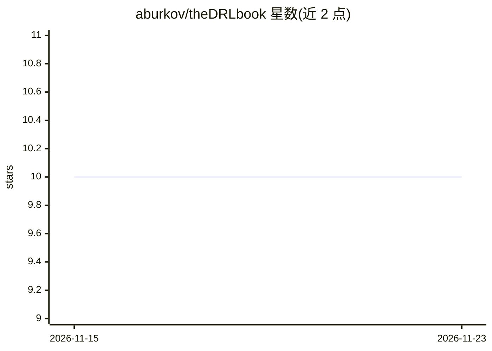

# aburkov/theDRLbook

⭐ 10 · Jupyter Notebook · 推送 2026-10-31 · [GitHub](https://github.com/aburkov/theDRLbook) · [官网](http://www.thedrlbook.com) · 个人维护

**《百页深度强化学习》官方代码仓库**

Andriy Burkov 所著 The Hundred-Page Deep Reinforcement Learning Book 的官方仓库，截至可见内容仅声明为'即将出版书籍'的官方存储库，README 未列出代码结构、安装步骤或使用说明。主题标签涉及深度学习、深度强化学习与 PyTorch，推断仓库将承载与书籍配套的代码或资源，具体内容以仓库后续更新为准。

## 筛选速览

| 维度 | 判定 | 备注 |
|---|---|---|
| AI 角色 | `ai-knowledge` | 知识聚合/清单类 |
| 许可风险 | `none` | — |
| 部署形态 | `None` |  |
| 模型依赖 | — | README 未给出锁定关系 |
| 硬件要求 | — | 无带数字的原话,不猜 |
| 安装摩擦 | `low` | 无编译、无系统依赖或容器化 |
| 成熟度 | `idea` | |

## 能力要点

- Andriy Burkov 所著 DRL 书籍的官方仓库
- 主题标签含深度强化学习与 PyTorch

## 适用场景

- 查找该书官方配套代码与资源
- 跟踪书籍出版进展

## 场景标签

`教程课程` · 领域:学习与行业

## 证据(README 行号)

> L3: This is the official repository of the upcoming book.

## 星数曲线

2026-11-15 10 → 2026-11-23 10（+0）

---
*卡片 v1 · prompt 1.4 · 生成 2026-11-20 · 置信度 mid · 依据 README sha `62d1ef812d31` · [字段定义](../../DATASET.md)*
