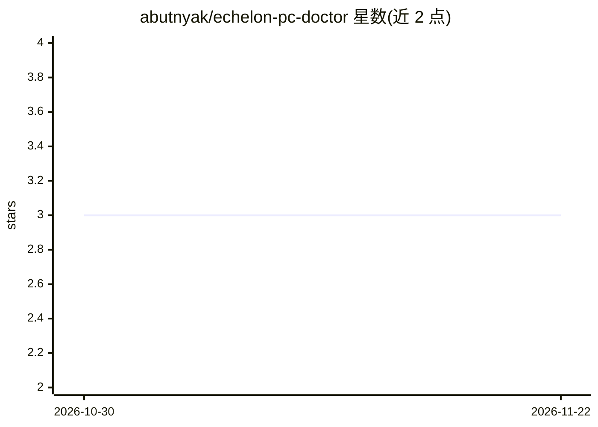

# abutnyak/echelon-pc-doctor

⭐ 3 · NOASSERTION · 推送 2026-11-02 · [GitHub](https://github.com/abutnyak/echelon-pc-doctor) · [官网](https://www.echelon-scum.com/) · 个人维护

**面向 Windows 游戏用户的 AI 优化提示词：让 Antigravity 代理清理与调优 PC**

仓库内容为两个功能等同的系统提示词文件（乌克兰语/英语版），供用户在 Google Antigravity AI 代理环境中运行，也可用于其他有终端访问权限的 AI 工具。代理按两阶段流程工作：先做只读扫描并输出三级报告（安全垃圾/自选/硬件与管理员级），强制暂停等待用户以单词回复授权，再创建系统还原点、注册表备份与一键回滚脚本后执行清理与调优。覆盖存储清理、DriverStore 去重、着色器缓存、游戏盘点、浏览器数据库压缩等 14 个模块，自称 MIT 许可、无广告无遥测。

## 筛选速览

| 维度 | 判定 | 备注 |
|---|---|---|
| AI 角色 | `ai-knowledge` | 知识聚合/清单类 |
| 许可风险 | `none` | NOASSERTION |
| 部署形态 | `desktop` | 安装包/桌面程序 |
| 模型依赖 | — | README 未给出锁定关系 |
| 硬件要求 | — | 无带数字的原话,不猜 |
| 安装摩擦 | `medium` | 含编译或系统依赖之一 |
| 成熟度 | — | 结构信号不足 |

## 能力要点

- 两阶段人机协同流程：只读扫描后强制安全暂停，单词级回复菜单节省约 80% AI token
- 执行前自动创建系统还原点、.reg 备份与一键回滚脚本
- 14 个工程模块覆盖 SSD 清理、游戏盘点、浏览器 SQLite VACUUM 与 VRAM 优化
- 按 Intel/AMD Ryzen/X3D 与 NVIDIA/Radeon/Intel Arc 硬件自适应规则

## 适用场景

- 清理 Windows 10/11 系统垃圾并释放数十 GB SSD 空间
- 为 CS2、SCUM 等游戏做 FPS 与延迟优化
- 审计自启动项、浏览器扩展权限与局域网设备
- 清理 iPhone 备份、着色器缓存等隐藏大文件

## 场景标签

 · 领域:系统工具/PC 优化

## 证据(README 行号)

> L31: * 🇺🇦 **`ECHELON_PC_DOCTOR_UA.md`** — Full Ukrainian Edition (`v1.1`)
> L32: * 🇬🇧 **`ECHELON_PC_DOCTOR_EN.md`** — Full English Edition (`v1.1`)
> L64: **ECHELON PC DOCTOR (`v1.1`)** is a 100% universal engineering system prompt **specifically built, tested, and opti

## 星数曲线

2026-10-30 3 → 2026-11-22 3（+0）

---
*卡片 v1 · prompt 1.4 · 生成 2026-11-22 · 置信度 mid · 依据 README sha `f156b8dd79fb` · [字段定义](../../DATASET.md)*
