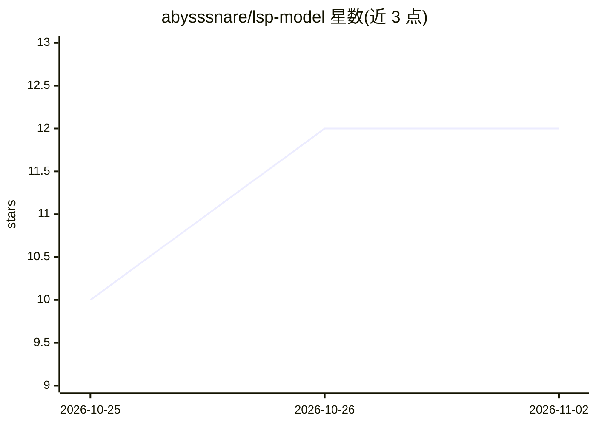

# abysssnare/lsp-model

⭐ 12 · Kotlin · 推送 2026-07-23 · [GitHub](https://github.com/abysssnare/lsp-model) · [官网](https://aceguru-mjh.github.io/LSPatch-Noroot-modle) · 个人维护 · 中文 README

**20 个 Android Xposed 模块合集仓库，附 AI 开发指南与体检脚本**

统一管理 11 个 NoRoot（LSPatch）与 9 个 Root（LSPosed+Magisk）版本 Xposed 模块的总仓库，功能覆盖广告拦截、隐私保护、游戏加速、微信 QQ 增强等。每个模块为独立 Gradle 工程，由 GitHub Actions matrix 并行构建。仓库另含 AI_DEV_GUIDE.md——供 AI Agent 阅读的项目宪法（Hook 编写规范、IPC 规范、三大铁律），以及 healthcheck.py 体检脚本，扫描铁律违反、空壳 Hook、版本号一致性并输出 health-report.json。

## 筛选速览

| 维度 | 判定 | 备注 |
|---|---|---|
| AI 角色 | `ai-enhanced` | 去掉 AI 部分产品仍成立 |
| 许可风险 | `none` | — |
| 部署形态 | `None` |  |
| 模型依赖 | — | README 未给出锁定关系 |
| 硬件要求 | — | 无带数字的原话,不猜 |
| 安装摩擦 | `medium` | 含编译或系统依赖之一 |
| 成熟度 | — | 结构信号不足 |

## 能力要点

- 20 个模块分 NoRoot（LSPatch）与 Root（LSPosed+Magisk）双版本管理
- AI_DEV_GUIDE.md 作为 AI Agent 阅读的项目开发宪法
- healthcheck.py 体检脚本输出 health-report.json
- 三大铁律约束 XposedLoader 反射加载与进程双分支

## 适用场景

- 获取广告拦截、隐私保护等功能的 Xposed 模块
- 按 AI 开发指南参与 Xposed 模块开发
- 用体检脚本检查模块是否符合仓库铁律

## 场景标签

 · 领域:Android 定制/开发工具

## 证据(README 行号)

> L7: 本仓库是 LSP 模块的**总仓库**，统一管理 NoRoot + Root 两个版本，并提供 AI 开发指南与体检工具。
> L56: AI_DEV_GUIDE.md 是给 AI Agent 阅读的项目宪法，包含：

## 星数曲线

2026-10-25 10 → 2026-11-02 12（+2）

---
*卡片 v1 · prompt 1.4 · 生成 2026-11-01 · 置信度 high · 依据 README sha `df251fde7e95` · [字段定义](../../DATASET.md)*
