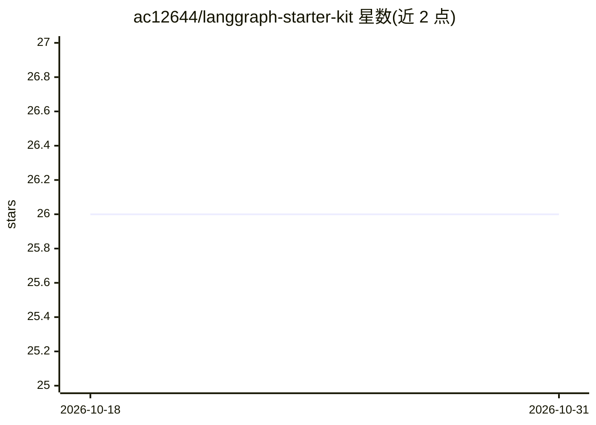

# ac12644/langgraph-starter-kit

⭐ 26 · TypeScript · Apache-2.0 · 推送 2026-10-17 · [GitHub](https://github.com/ac12644/langgraph-starter-kit) · [官网](https://www.npmjs.com/package/create-langgraph-app   ) · 个人维护

**LangGraph 多智能体应用脚手架：7 种模式、6 家 LLM 提供商开箱即用**

面向 TypeScript 开发者的 LangGraph 多智能体启动套件，通过 npx create-langgraph-app 交互式生成项目，或克隆含全部模式的完整套件。内置 7 种 agent 模式（Supervisor、Swarm、HITL、结构化输出、Research、RAG、客服机器人），支持 6 家 LLM 提供商（OpenAI、Anthropic、Google、Groq、DeepSeek、本地 Ollama）经单个环境变量切换。基于 LangChain createAgent v1 API 与 subagents/handoffs 模式实现，不依赖上游已停止维护的 supervisor/swarm 包。附带 Fastify HTTP 服务（invoke/SSE 流式/resume/线程历史）、MCP 工具接入、LangSmith 追踪、内存/Postgres 持久化与 Docker Compose 部署配置，含 66 个 vitest 测试。

## 筛选速览

| 维度 | 判定 | 备注 |
|---|---|---|
| AI 角色 | `ai-ecosystem` | LLM/agent 周边工具 |
| 许可风险 | `permissive` | Apache-2.0 |
| 部署形态 | `self-host` | docker 或自建部署 |
| 模型依赖 | local-ok | 支持本地模型 |
| 硬件要求 | — | 无带数字的原话,不猜 |
| 安装摩擦 | `low` | 无编译、无系统依赖或容器化 |
| 成熟度 | — | 结构信号不足 |

## 能力要点

- 7 种 agent 模式：Swarm、Supervisor、HITL、结构化输出、Research、RAG、客服机器人
- 6 家 LLM 提供商经单个 LLM_PROVIDER 环境变量切换（含本地 Ollama）
- Fastify HTTP 服务支持 invoke、SSE 流式、HITL resume 与线程历史
- MCP 工具接入（stdio/http 传输）与 LangSmith 追踪、Postgres 持久化、Docker Compose 部署

## 适用场景

- 快速搭建多智能体后端服务，省去 supervisor 与 provider 配置样板代码
- 对比体验 Supervisor、Swarm、HITL 等 agent 架构模式
- 构建基于自有文档的 RAG 问答或多域客服机器人
- 用本地 Ollama 无 API key 运行 RAG 与多智能体流程

## 场景标签

`Agent 框架` `多智能体` `RAG` · 领域:Agent 开发

## 证据(README 行号)

> L3:  The fastest way to build production-ready multi-agent apps with LangGraph.
> L23: Building multi-agent systems with LangGraph means writing the same boilerplate over and over — setting up superviso
> L51: |**CLI**|Scaffolder|`npx create-langgraph-app` — interactive project generator|

## 星数曲线

2026-10-18 26 → 2026-10-31 26（+0）

---
*卡片 v1 · prompt 1.4 · 生成 2026-10-26 · 置信度 high · 依据 README sha `5aac4666760a` · [字段定义](../../DATASET.md)*
