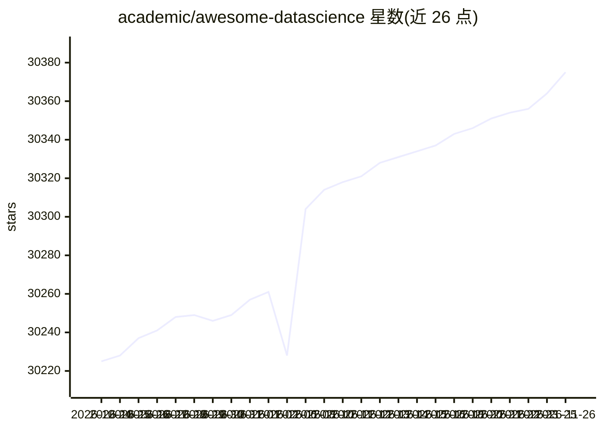

# academic/awesome-datascience

⭐ 30,375 · MIT · 推送 2026-11-24 · [GitHub](https://github.com/academic/awesome-datascience) · 组织维护

**数据科学学习资源清单：入门路径与工具/课程索引**

以清单形式组织的数据科学学习路径仓库：回答“什么是数据科学、该学什么”的问题，汇总专家解答链接、Python/R 语言选择说明、Pip/Anaconda 包管理介绍，以及 Pandas、NumPy、Scikit-Learn、Seaborn 等入门库说明，并给出包含 Python、核心库、Kaggle 练习、数学基础到机器学习的初学者路线图；另设 Agents 章节收录面向数据科学工作流的 agent 框架与工具条目。面向数据科学初学者与从业者。

## 筛选速览

| 维度 | 判定 | 备注 |
|---|---|---|
| AI 角色 | `ai-knowledge` | 知识聚合/清单类 |
| 许可风险 | `permissive` | MIT |
| 部署形态 | `library` | 以包/库形式分发 |
| 模型依赖 | — | README 未给出锁定关系 |
| 硬件要求 | — | 无带数字的原话,不猜 |
| 安装摩擦 | `low` | 无编译、无系统依赖或容器化 |
| 成熟度 | — | 结构信号不足 |

## 动量与使用信号

- 维护:`active` — 距上次 push 0.8 天,年发版 12,329 位贡献者
- 涨星:近 1 天 **+7**(自 20261016 起算)
- 安装:github 包 `release-assets` 月下载无数据
- 平台:— · 协议:OPENAI-API / MCP / OLLAMA

## 能力要点

- 汇总数据科学定义与专家解答的链接表
- 初学者路线图：Python→核心库→Kaggle 项目→数学→ML
- Python/R 语言与 Pip/Anaconda 包管理说明
- Agents 章节收录数据科学工作流相关框架与工具

## 适用场景

- 我想入门数据科学，找一条学习路径
- 我需要查找数据科学领域的课程与文章资源
- 我在为数据科学工作流挑选 agent 工具

## 场景标签

`精选清单` · 领域:学习与行业

## 证据(README 行号)

> L9: **An open-source Data Science repository to learn and apply concepts toward solving real- world problems.**
> L11: This is a shortcut path to start studying **Data Science**. Just follow the steps to answer the questions, "What is
> L62: ## Agents

## 星数曲线

2026-10-24 30,225 → 2026-11-26 30,375（+150）

---
*卡片 v1 · prompt 1.4 · 生成 2026-11-22 · 置信度 mid · 依据 README sha `59235a0ef6f3` · [字段定义](../../DATASET.md)*
